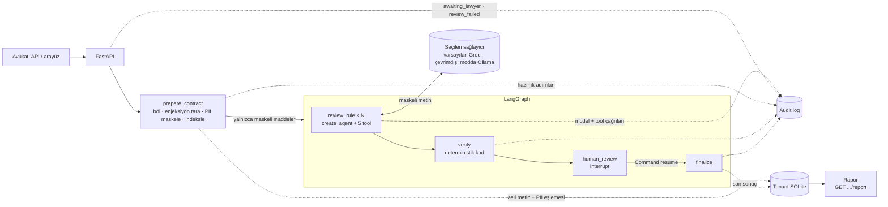

# Mimari

## 1. Genel bakış
Sistem dört katmandan oluşur: **Hazırlık → Agent → Doğrulama → İnsan**.

- **Hazırlık** düz Python fonksiyonlarıdır ve graph'tan **önce** çalışır: sözleşmeyi maddelere böler,
  enjeksiyon tarar, PII maskeler, indeksler. Böylece ham metin graph state'ine hiç girmez.
- **Agent, Doğrulama ve İnsan** katmanları bir LangGraph `StateGraph`'tır. Her kural için ayrı bir
  `create_agent` görevi çalışır; doğrulama düz koddur; graph tek bir `interrupt()` noktasında durur.
- Avukat kararını API'den verir ve graph `Command(resume=...)` ile biter. Son karardan sonra
  sonuçları, önerileri ve avukat kararlarını içeren bir rapor okunabilir.

İlke: **LLM önerir, kod karar verir, yalnızca avukat onaylar.**



## 2. Bileşenler
| Bileşen | Sorumluluk | Konum |
|---|---|---|
| API | Anahtardan tenant ve rol çözme, rol kontrolü, hazırlığı çağırma, inceleme başlatma, avukat kararını doğrulama ve maskeleme, role göre gösterim, audit ve rapor okuma, arayüz | `src/api.py` |
| Hazırlık | Madde bölme, enjeksiyon tarama, PII maskeleme, BM25 indeksi (graph dışında) | `src/prepare/` |
| Metin yardımcısı | Metni normalleştirir ve her karakterin asıl metindeki konumunu verir; enjeksiyon taraması ve alıntı doğrulaması aynı yardımcıyı kullanır, ikinci bir kopyası yazılmaz | `src/text.py` |
| Rapor | Saklanan sonuçtan JSON rapor üreten saf fonksiyon | `src/report.py` |
| Graph | 4 düğüm, `Send` ile kural başına dağıtım, tek `interrupt()` | `src/graph.py` |
| Kural agent'ı | `create_agent`, system prompt, audit middleware'leri, adım limiti | `src/agent.py` |
| Tool'lar | 5 tool; onay tool'u yok | `src/tools.py` |
| Doğrulama | Alıntı, sayı/birim, taslak kontrolü, avukat kuyruğu sinyalleri (saf fonksiyon) | `src/verify.py` |
| Karar | Avukat kararının saf fonksiyonları (I/O ve log yok): kayda bakan gövde kontrolleri (`check_decision`), son sonucun hesabı (`build_outcome`), karar ve kapanış audit olaylarının listesi (`decision_events`); biçim kuralları da burada tek yerde yazılır ve iki karar modeli onları çağırır | `src/decision.py` |
| Config | Env okuma; başlangıçta sağlayıcı adı, model ve anahtar kontrolü (eksikse açık hatayla durur); bilinen sağlayıcı tablosu (varsayılan model, birim fiyat) | `src/config.py` |
| LLM | Sohbet modeli kurulumu (`init_chat_model`; Groq ve Ollama'ya özel parametreler, diğer her sağlayıcıya ortak parametreler); yeniden deneme ayarı; sağlayıcı hatasının sınıflandırılması ve hatadan HTTP durum kodunu okuyan yardımcı (audit'teki `code` alanı da onu kullanır) | `src/llm.py` |
| Store | Tenant'a bağlı SQLite, üç tablo: `reviews` (asıl sözleşme metni, maskeli maddeler, işaretler, durum, doğrulanmış bulgular ve taslaklar, kararlar), `audit_log` (tetikleyiciyle yalnızca ekleme), `pii_map`. Maddeler, işaretler, bulgular ve karar `reviews` satırında JSON sütunlarıdır. Durum değiştiren yazımlar (`save_findings`, `complete_review`, `mark_failed`) beklenen durumu `WHERE status = ?` ile şart koşar ve geçişin olup olmadığını döner; aynı anda gelen iki karardan yalnızca biri yazılır. `save_findings` durumu `awaiting_lawyer` yaparken `awaiting_lawyer` audit satırını **aynı transaction'da** yazar (ya ikisi ya hiçbiri; ayrı yazılsaydı ikinci yazımın hatası audit satırı olmayan ve artık `failed` yapılamayan bir `awaiting_lawyer` incelemesi bırakırdı). `complete_review(review_id, status, decision: ReviewOutcome, decided_by, events)` de öyledir: tek `BEGIN IMMEDIATE` içinde `UPDATE … WHERE review_id = ? AND status = 'awaiting_lawyer'` çalışır; satır güncellendiyse verilen tüm olay satırları (karar olayları, `report_created`, `review_closed`) aynı transaction'da eklenir, güncellenmediyse hiçbir şey yazılmaz ve `False` döner. Bulguları (`findings`) yeniden yazmaz; `decided_by` sütununa yalnızca ad yazılır | `src/store.py` |
| Modeller | pydantic şemaları: `RawClause`, `Clause`, `Rule`, `Finding`, `Proposal`, `InjectionFlag`, `FindingDecision` / `LawyerDecision` (avukat kararının iç modeli; `edited_text: MaskedText`, yalnızca maskelemeden sonra kurulur; resume yükü ve `finalize` onu kullanır), `FindingOutcome` / `ReviewOutcome` (saklanan son sonuç; `ReviewRecord.decision` bu tiptedir), `Report`. Karar ucunun istek modelleri (`DecisionRequest`, `FindingDecisionRequest`) burada değil `src/api.py`'dedir (§3 "Avukat kararı"). Ham ve maskeli madde tip düzeyinde ayrıdır: `RawClause` (`text: str`, asıl metnin `start`–`end` aralığı, birebir) yalnızca bölme ve enjeksiyon taramasında kullanılır; `Clause` (`text: MaskedText`) yalnızca maskelemeden sonra kurulur ve indeks, `save_prepared`, graph ve tool'lar yalnızca onu alır. `Clause`'ta `start` / `end` asıl metne göredir, `text` maskelidir ve uzunluğu `end - start`'a eşit olmayabilir. `MaskedText` bir `NewType`'tır; yalnızca `mypy`'de zorlanır, çalışma anında düz `str`'dir (sınır). `Finding` tektir: agent'ın ham önerisi ve doğrulanmış hali aynı modeldir (`needs_review`, `review_reasons` ve taslağın `code_check`'i doğrulamada dolar); `compliant` / `non_compliant` için `clause_id` ve `quote` zorunluluğu modelin kendisindedir. `interrupted_by` (`step_limit` / `rate_limited` / `llm_error`) bulgu bildirildikten sonra yarıda kesilen koşuyu işaretler; `no_finding_reason` ile birlikte dolu olamaz. Bilinmeyen alan reddedilir | `src/models.py` |
| Arayüz | Bulguları ve enjeksiyon işaretlerini sözleşme metni üzerinde gösteren tek sayfa (karar API ucundan verilir) | `src/static/index.html` |

## 3. Veri akışı (ana senaryo)
1. `POST /reviews` gelir; gövdesi `{"text": "…"}`'tir. API anahtarından `tenant_id` ve rol çözülür
   (aşağıda "Kimlik ve rol"); tenant'ın kuralları yüklenir. İncelemeye bir `review_id` (UUID) verilir.
2. **Hazırlık (graph dışı, `prepare_contract()`), şu sırayla:**
   - **Sakla:** Asıl sözleşme metni değiştirilmeden tenant'ın `app.db`'sine kaydedilir.
   - **Böl:** Sözleşme maddelere bölünür; her madde asıl metindeki ofsetini taşır. Başlık
     `Madde N`'dir; metinde hiç yoksa numaralı Markdown başlığı (`## 4. Fesih`); o da yoksa düz
     numaralı başlık (`7. SORUMLULUK`; büyük harfli, paragraf başında, hemen ardından kendi alt
     maddesi `7.1` gelen, 1..n sıralı; Adım 19f); o da yoksa metin paragraflara bölünür. İlk başlıktan önceki ve son maddeden sonraki metin de birer maddedir
     (sınır ve kimlik kuralları, paragraf kipinin bilinen sınırı: `agent_design.md` §4 "RAG").
   - **Tara:** Enjeksiyon kalıpları ve gizli karakterler, görünmez karakterleri çıkarılmış bir
     kopyada taranır; eşleşme konumları asıl metne eşlenir (`src/text.py`). Şüpheli ifade
     **silinmez**, konumuyla işaretlenir. Modelin göreceği kopyadan yalnızca görünmez karakterler
     çıkarılır; görünen şüpheli cümle kalır. Görünmez karakter kümesi tek yerde tanımlanır
     (küme, BOM istisnası ve işaretin alanları: `agent_design.md` §5 "Girdi güvenliği").
   - **Maskele:** Kimlik bilgileri yer tutucularla değiştirilir (`[KISI_1]`, `[TCKN_1]`); eşleme
     yalnızca tenant'ın `app.db`'sine yazılır. Tutar, süre ve tarihler maskelenmez.
   - **İşareti maskele:** İşaretteki ifade (eşleşmenin geçtiği cümle) aynı eşlemeyle maskelenir;
     maskesiz hali saklanmaz.
   - **İndeksle:** Maskeli maddeler BM25 ile indekslenir. İndeks state'e konmaz; süreç içinde
     `(tenant_id, review_id)` anahtarlı bir sözlükte durur ve graph `interrupt`'a ulaşınca silinir.
   - Her adım audit log'a yazılır; audit olayları yükleri maskelendikten sonra yazılır.
   - **Hazırlık yarıda kalırsa:** asıl metin kaydedildikten sonra bir hata çıkarsa
     `prepare_contract` incelemeyi `failed` yapar, `review_failed` (`reason: prepare_error`; hata
     metni PII taşıyabileceği için yazılmaz) kaydını ekler, indeksi siler ve hatayı yeniden fırlatır.
     Satır `running` kalmaz.
3. Graph **yalnızca maskeli maddeler, kurallar, enjeksiyon işareti ve kimliklerle** başlar
   (`thread_id = review_id`).
4. **review_rule × N:** Her kural için bir agent çalışır ve tam olarak bir bulgu döner. Arar, maddeyi
   okur, `submit_finding` ile bildirir; gerekiyorsa `propose_change` ya da `escalate_to_lawyer` çağırır.
   Her model ve tool çağrısı audit log'a yazılır.
5. **verify:** Kod her bulguyu ve taslağı kontrol eder; `needs_review` işaretini ve sebep listesini
   koyar (LLM değil). Sebep kodlarının tamamı ve koşulları `agent_design.md` §5 sinyal tablosundadır
   (`models.ReviewReason` ile aynı sırada); "uygun" bulgunun gösterdiği maddede `TCKN` / `TELEFON`
   yer tutucusu varsa `masked_value_in_clause` de bunlardandır (maskelenmiş bir sayı kodca okunamaz).
   Kuralında `check` olmayan bir bulgunun taslağı varsa kod taslağı denetleyemez
   (`code_check=unverifiable`) ve bulgu `proposal_unverifiable` ile kuyruğa girer. Taslak
   maddenin tamamının yerine geçer; maddenin satır başındaki alt madde numaralarından (`3.1.`)
   birini taslakta taşımayan taslak `proposal_partial` ile kuyruğa girer (Adım 19f; `code_check`
   değişmez). Bulgunun maddesinden başka bir maddeye yazılmış taslak
   `proposal_clause_mismatch` ile kuyruğa girer (Adım 19g; `code_check` değişmez).
6. **human_review:** Graph `interrupt()` ile durur. Graph döndükten sonra API doğrulanmış bulguları
   ve taslakları (maskeli) `reviews` tablosuna yazar, durumu `awaiting_lawyer` yapar, `awaiting_lawyer`
   audit satırını aynı transaction'da ekler, indeksi siler ve incelemeyi HTTP 200 ile döner (yanıt
   `GET /reviews/{id}` yanıtıyla aynı fonksiyondan çıkar; çağıran `lawyer` olduğu için maskesiz).
   Graph ya da bu yazım hata verirse inceleme `failed` olur, `review_failed` yazılır ve indeks yine
   silinir (502 / 500; `agent_design.md` §6 ve §7). Bu andan sonra okuma uçları ve karar doğrulaması
   `reviews` tablosunu okur; checkpoint'i okumaz.
7. `POST /reviews/{id}/decision` gelir. API rolü ve kararı **graph'ı devam ettirmeden önce** kontrol
   eder, avukatın yazdığı düzenlenmiş metni maskeler (aşağıda) ve kararı verenin adını anahtardan
   alıp yüke ekler. İşleyicinin gövdesi tenant'ın **karar kilidi** altında çalışır (kilit
   `(çözülmüş data_dir, tenant_id)` ile anahtarlanır; bir tenant'ın kararı ötekini bekletmez), bu
   sırayla: kaydı yeniden oku → `awaiting_lawyer` değilse 409 → kayda bakan gövde kontrolleri (422)
   → ancak ondan sonra eşlemeyi oku, `edited_text`'i maskele, iç `LawyerDecision`'ı kur → yeni
   eşleme girdilerini yaz → checkpoint'in `next`'i `("human_review",)` ya da `("finalize",)` değilse
   dur (500, tutarsız durum) → graph `Command(resume=yük, update={"decision": yük})` ile devam eder
   (gerekçe: `agent_design.md` §1) → kaydı oku ve yanıtla. Başarılı yanıt **200** ve
   `GET /reviews/{id}` ile aynı gövdedir (aynı fonksiyondan; çağıran `lawyer` olduğu için maskesiz).
8. **finalize:** Bulguların son sonucunu hesaplar (`build_outcome`) ve `Store.complete_review` ile
   **tek transaction'da** durumu (`approved` / `changes_requested`), son sonucu, karar zamanını ve
   kararı verenin adını `reviews` kaydına, karar olaylarını, `report_created` ve `review_closed`'ı
   audit log'a yazar (yükler: `agent_design.md` §7). Kayıt raporun ihtiyaç duyduğu her şeyi içerir:
   `findings` sütunu modelin sonucunu, madde, alıntı, `needs_review` ve sebepleri, taslak ve
   `code_check`'i olduğu gibi tutar (`Finding` değişmez; avukat madde ya da alıntı veremez,
   `not_found → non_compliant` düzeltmesinde ikisi boş kalır); `decision` sütunu `ReviewOutcome`'u
   tutar: `contract_decision` ve kural sırasında, kural başına bir `FindingOutcome` (`rule_id`,
   state'teki kural kopyasından `severity`, `final_status`, `action`, `proposal_action`,
   maskeli `edited_text`; avukatın dokunmadığı bulgu için de yazılır, `action: null`). Sağlayıcı ve
   model kaydın kendi sütunlarındadır. `approved_with_noncompliant` ve talep edilen değişiklik
   listesi saklanmaz; rapor fonksiyonu onları saklanan sonuçtan türetir. Rapor yalnızca bu kayıttan
   üretilir (`rules.yaml` sonradan değişse de rapor değişmez).
   **`finalize` hata verirse** (ya da resume başka bir sebeple fırlarsa) API 500 döner; transaction
   atomik olduğu için yarım kayıt yoktur: inceleme `awaiting_lawyer`'da kalır, audit'e satır
   eklenmez, `review_failed` yazılmaz ve avukat aynı ya da farklı kararı yeniden gönderebilir
   (`agent_design.md` §6).

İnceleme durumları: `running → awaiting_lawyer → approved | changes_requested` (hata: `failed`).

### API uçları
| Uç | İş | Gerekli rol |
|---|---|---|
| `POST /reviews` | Sözleşme metnini alır (`{"text": "…"}`), hazırlar, graph'ı `interrupt`'a kadar çalıştırır, bulguları döner | `lawyer` |
| `POST /reviews/{id}/decision` | Bulgu kararları + taslak kararları + son karar (onay / değişiklik talebi), tek istekte; başarıda `GET /reviews/{id}` ile aynı gövde | `lawyer` |
| `GET /reviews/{id}` | Durum, maddeler, enjeksiyon işaretleri, bulgular, taslaklar; `lawyer` için ayrıca asıl sözleşme metni | `lawyer` ya da `viewer` |
| `GET /reviews/{id}/report` | Son karardan sonra rapor (yalnızca JSON) | `lawyer` ya da `viewer` |
| `GET /reviews/{id}/audit` | İncelemenin audit kayıtları | `lawyer` ya da `viewer` |
| `GET /` | Basit arayüz (veri içermez; veriyi `GET /reviews/{id}`'den çeker) | — |

**Arayüz (`GET /`).** Sayfa `src/static/index.html` dosyasıdır; `create_app` onu bir kez okur
(dosya yoksa uygulama başlamaz) ve her istekte aynı baytları `text/html; charset=utf-8` olarak
döner. Anahtar istemez, isteğe göre değişmez, veri içermez. Yanıt başlıkları:
`Content-Security-Policy: default-src 'none'; connect-src 'self'; style-src 'unsafe-inline';
script-src 'sha256-…'; base-uri 'none'; form-action 'none'; frame-ancestors 'none'` (özet sayfadaki
tek `<script>` bloğunun içeriğinden başlangıçta hesaplanır), `X-Content-Type-Options: nosniff`,
`Referrer-Policy: no-referrer`, `Cache-Control: no-store`.

- **Yalnızca okur.** Kullanıcı anahtarı ve inceleme kimliğini girer; sayfa yalnızca
  `GET /reviews/{id}` çağırır. İnceleme başlatma, karar, rapor ve audit gösterimi sayfada yoktur
  (karar yalnızca API ucundan verilir). Hata durumunda (401 / 404 / ağ) yalnızca durum kodu ve
  sabit bir mesaj gösterilir.
- **Rolü yanıttan anlar:** yanıtta `original_text` varsa `lawyer` görünümü, yoksa `viewer` görünümü
  çizilir. Sayfada rol seçimi yoktur.
- **`lawyer` görünümü** asıl metni (`original_text`) gösterir. Konumlar Python kod noktası
  ofsetidir; sayfa metni `Array.from(text)` ile kod noktalarına göre dilimler. Madde sınırları
  `clauses[].start` / `end` ile, enjeksiyon işaretleri `injection_flags[].start` / `end` ile
  işaretlenir; işaretin `kind` ve `detail` değeri yanında etiket olarak yazılır (gizli karakter
  görünmez olduğu için aralığın yanına görünür bir etiket konur). Alıntı (`quote`), bulgunun
  maddesinin asıl metin diliminde **birebir** aranır: tam bir kez bulunursa o aralık, aksi halde
  (bulunamadı, birden çok kez geçti, araya gizli karakter girdi, maske açılınca yazım değişti)
  **maddenin tamamı** işaretlenir ve bulgu kartında "alıntının yeri gösterilemedi, madde
  işaretlendi" yazar. Hizalama denenmez; yanlış yere vurgu yapılmaz.
- **`viewer` görünümü** maskeli madde metinlerini (`clauses[].text`) alt alta gösterir. Alıntı ve
  işaretin `phrase` değeri madde metninde aynı kuralla aranır (tam bir kez → aralık, değilse madde).
- İki görünümde de yanda bulgu listesi vardır: kural, sonuç, son sonuç ve karar alanları (varsa),
  `needs_review` ve sebepleri, gerekçe, taslak (`proposed_text`, `rationale`, `code_check`,
  `edited_text`). Maddesi olmayan bulgu (`not_found`, `no_finding`) yalnızca listede görünür.
  Çakışan vurgular (alıntı ile işaret) sınır noktalarına göre parçalanır; bir parça birden çok sınıf
  taşıyabilir.
- **Sınır:** sayfanın JS mantığı otomatik testle sınanmaz (yığında JS test koşucusu yok); tarayıcıda
  elle denenir. Sunucu tarafı (başlıklar, veri içermeme, yasak API'lerin kaynakta geçmemesi) testlidir.

Bulgu ve taslak kararlarını değiştiren tek uç `/decision`'dır; avukat aşaması bilerek bu tek uçla
kurulur. Kural uç adına değil yönteme bağlıdır: **`GET` dışındaki her uç `lawyer` rolü ister.**
İleride eklenen bir yazma ucu da bu kurala girer; bunu bir test zorlar (`evals.md` §2).

### Role göre gösterim
| Veri | `lawyer` | `viewer` |
|---|---|---|
| Maddeler, alıntılar, taslaklar, avukatın düzenlediği taslak metni (`edited_text`), rapor | **Maskesiz** (yer tutucular gerçek değerle değiştirilir) | **Maskeli** (yer tutucular olduğu gibi) |
| Enjeksiyon işaretleri | Madde, tür, eşleşen ifade (maskesiz), asıl metindeki konum, gizli karakterlerin türü ve konumu | Madde, tür ve eşleşen ifade (maskeli); konum ve gizli karakter ayrıntısı yok |
| Maddelerin asıl metindeki ofseti (`start` / `end`) | Var | **Yok** |
| Asıl sözleşme metni (`original_text`) | Var; işaret konumları bu metne göre karakter ofsetidir | **Yok** |
| Audit kayıtları | Saklandığı gibi, maskeli | Saklandığı gibi, maskeli |

- Kural tüm okuma uçlarında ve arayüzde aynıdır. Maske açma her `lawyer` yanıt modeli için
  tek bir fonksiyondadır (inceleme yanıtı için bir tane, rapor için bir tane; ikisi de `src/api.py`'de
  yan yana ve aynı `unmask`'i çağırır) ve yalnızca yanıt üretilirken, `lawyer` için çalışır; saklanan veri her zaman maskelidir (asıl sözleşme metni
  ve `pii_map` dışında).
- **Yanıt sabit alan listesiyle kurulur, kayıttan alan çıkarılarak değil.** İnceleme, madde, işaret
  ve bulgu için ayrı yanıt modelleri vardır ve her biri yalnızca adı yazılmış alanları taşır
  (`Finding` ya da `ReviewRecord` olduğu gibi dökülmez). `lawyer` yanıtı `viewer` alanları artı
  açıkça eklenenlerdir: `original_text`, madde ofsetleri, işaretin `start` / `end` / `detail`
  alanları. Kayda sonradan eklenen bir alan listeye yazılmadıkça hiçbir role gitmez; unutulan alan
  görünmez olur, sızmaz. Maske açma kurulmuş `lawyer` yanıtındaki tüm metin alanlarında çalışır;
  `viewer` için `pii_map` hiç okunmaz.
- **Karar alanları** iki role de aynı listeyle gider: bulguda `final_status`, `action`,
  `proposal_action`, `edited_text`; incelemede `contract_decision`, `decided_at`, `decided_by`.
  Karardan önce hepsi `null`'dır. `edited_text` maske açma fonksiyonunun alan listesindedir
  (`lawyer` maskesiz, `viewer` maskeli). `provider` / `model` inceleme yanıtına girmez (rapor
  başlığında yer alır).
- `viewer` için "konum yok" kuralı inceleme ve rapor yanıtlarına uygulanır; audit kayıtları iki rol
  için de saklandığı gibi döner. **İşaret konumları `viewer`'dan gizlenmiş sayılmaz:**
  `injection_flagged` audit satırı işaretin `start` / `end` / `detail` alanlarını taşır ve `viewer`
  onu okuyabilir. İnceleme yanıtına konmamalarının sebebi gizlilik değil, `viewer`'da olmayan asıl
  metne göre ofset oldukları için işe yaramamalarıdır. Madde ofsetleri ise hiçbir audit yükünde
  yoktur: ofset aralığı ile maskeli metnin uzunluğu arasındaki fark maskelenen değerlerin
  uzunluğunu vereceği için `viewer`'a hiçbir uçtan verilmez.
- `viewer` asıl sözleşme metnini ve `pii_map`'i hiçbir uçtan alamaz.
- Arayüz veriyi API'den çektiği için aynı kurala kendiliğinden uyar.

### Kimlik ve rol
- Her istek `X-API-Key` başlığı taşır. Sunucu anahtarı `TENANT_API_KEYS` içinde arar; kayıt
  `tenant_id`, `role` (`lawyer` / `viewer`) ve `name` verir.
- **Tenant ve rol yalnızca buradan gelir.** İstek gövdesindeki, sorgu dizgisindeki ya da yoldaki
  `tenant`, `role`, `reviewer` gibi alanlar okunmaz; gönderilirse yok sayılır. İstemci bunları değiştiremez.
  (Tek ayrım: karar gövdesindeki `findings` öğesinin bilinmeyen alanı 422'dir; aşağıda "Avukat
  kararı". Gövdenin üst düzeyindeki bilinmeyen alan yine yok sayılır.)
- Anahtarlar sunucu tarafında env'de durur; yanıtlarda ve loglarda yer almaz.
- Kontrol sırası (ilk tutmayan döner; graph ancak hepsi geçerse devam eder):

| Sıra | Kontrol | Tutmazsa |
|---|---|---|
| 1 | Anahtar var ve tanınıyor | **401** |
| 2 | Uç yazma ucuysa rol `lawyer` | **403** |
| 3 | İnceleme bu tenant'a ait (yalnızca kendi `app.db`'sinde aranır) | **404** |
| 4 | Durum uygun: karar ucu için `awaiting_lawyer`; rapor ucu için `approved` / `changes_requested` | **409** |
| 5 | Gövde geçerli (karar ucu, aşağıda) | **422** |

Rol kontrolü kaynağa bakmadan önce yapılır; `viewer` başka tenant'ın incelemesi için de 403 alır,
yani incelemenin var olup olmadığını öğrenemez. İlk dört kontrol bağımlılıklardadır (incelemeyi
yükleyen bağımlılık 404, durumu denetleyen 409 verir; `review_id` yolda düz `str`'dir, UUID tipi
verilmez, yoksa 404 yerine 422 çıkardı); bağımlılıktaki `HTTPException` şema hatasından önce döner,
bu yüzden şemaya uymayan gövde de sırayla 401 / 403 / 404 / 409 alır. Karar ucunda 409'un asıl
koruması karar kilidi altındaki yeniden okumadır; bağımlılıktaki kontrol sırayı sağlar.

**Sıranın tek istisnası — sözdizimi bozuk JSON:** FastAPI gövdeyi bağımlılıklardan önce ayrıştırır;
gövdesi JSON olarak ayrıştırılamayan bir istek anahtar ve rol kontrolüne gelmeden **422** alır
(kurulu sürümle sınandı: gövde yokken, şema yanlışken ya da içerik tipi JSON değilken anahtarsız
istek 401 alır). Bu yanıt bir kaynağın var olup olmadığını söylemez ve hiçbir durumu değiştirmez;
bunun için ayrı bir kimlik katmanı (middleware) yazılmaz. Bir test bu davranışı sabitler.

`POST /reviews` gövdesi `{"text": "…"}`'tir (`text` boş olamaz); gövdedeki başka alanlar reddedilmez,
yok sayılır. Otomatik `/docs`, `/redoc` ve `/openapi.json` uçları kapalıdır.

**Metin uzunluğu sınırı — 413:** `POST /reviews` gövdesindeki `text` en fazla **2.000.000 karakter**
(Python `len()`, bayt değil; `src/api.py` içinde `MAX_CONTRACT_CHARS`) olabilir. Sınır aşılırsa
**413** döner. Kontrol uç fonksiyonunun içinde, anahtar ve rol çözüldükten sonra ve store, kural,
graph ya da hazırlık çağrılarından önce yapılır; bu yüzden anahtarsız istek (büyük gövdeyle bile)
401, boş ya da geçersiz gövde 422 almaya devam eder ve geçerli anahtarla aşan istek hiçbir kayıt
bırakmaz. 413 yanıtı sabit bir Türkçe cümledir: metni ya da bir parçasını asla geri yansıtmaz.
Sınıra gelmeden 422 alan büyük gövde (yalnızca boşluktan oluşan ya da tipi yanlış `text`) de geri
yansıtılmaz: FastAPI'nin varsayılan 422 gövdesi hatalı girdiyi `input` alanında geri yazar; bu
uygulamada 422 yanıtı her uçta yalnızca `type`, `loc` ve `msg` taşır (`create_app` içindeki
`RequestValidationError` işleyicisi).
Sınırın dürüst kapsamı: işlenen ve saklanan metni sınırlar, sunucunun okuduğu baytı **sınırlamaz**.
FastAPI tüm JSON gövdesini kontrolden önce ayrıştırır; bayt düzeyinde bir sınır ya da bunu yapacak
bir middleware yoktur.

### Avukat kararı (`DecisionRequest` → `LawyerDecision`)
```json
{
  "findings": [
    {
      "rule_id": "termination_notice",
      "action": "accept | correct",
      "status": "non_compliant",
      "proposal_action": "accept | edit | reject",
      "edited_text": "Taraflar sözleşmeyi 30 gün önceden yazılı bildirimle feshedebilir."
    }
  ],
  "contract_decision": "approve | request_changes"
}
```
**İki model.** Gövde önce `src/api.py`'deki istek modeliyle doğrulanır: `DecisionRequest` üst
düzeyde bilinmeyen alanı yok sayar (`extra="ignore"`; gövdedeki `role`, `reviewer`, `tenant` hiçbir
şeyi değiştirmez), liste öğesi `FindingDecisionRequest` ise bilinmeyen alanı **reddeder**
(`extra="forbid"`, 422). Sebep: öğede yanlış yazılmış bir alan (ör. `proposal_actoin`) yok
sayılsaydı, kuyruk dışındaki bir bulguda avukatın taslak kararı sessizce kaybolur ve kayda girmezdi.
Maskelemeden sonra `src/models.py`'deki iç model `LawyerDecision` / `FindingDecision` kurulur
(`extra="forbid"`, `edited_text: MaskedText | None`); resume yükü ve `finalize` yalnızca onu
kullanır. İç modelin kurulamaması kod hatasıdır (500), gövde hatası değil. `findings` verilmezse
boş listedir.

**Kim neye karar verir.** Avukat her bulguya değil, yalnızca **avukat kuyruğundaki**
(`needs_review=true`) bulgulara karar vermek zorundadır (CASE.md'deki gibi). İsterse kuyruk
dışındaki bir bulguyu da düzeltebilir.

| Alan | Anlamı | Ne zaman zorunlu |
|---|---|---|
| `action` | Bulgu kararı: `accept` (olduğu gibi) ya da `correct` (sonucu değiştir). `reject` yoktur. | Kuyruktaki her bulgu için. Kuyruk dışındakiler için isteğe bağlı. |
| `status` | Düzeltilmiş sonuç: `compliant` / `non_compliant` / `not_found` | `action = correct` ise |
| `proposal_action` | Taslak kararı: `accept` / `edit` / `reject` | Taslağı olan **kuyruktaki** her bulgu için. Taslağı olan kuyruk dışı bulgularda isteğe bağlı. |
| `edited_text` | Avukatın düzenlediği taslak metni; en fazla **20.000 karakter** | `proposal_action = edit` ise; başka durumda verilemez |
| `contract_decision` | Son karar: `approve` (onay) ya da `request_changes` (değişiklik talebi) | Her zaman |

Gövde doğrulaması (kontrol 5) — biri tutmazsa **422**, graph devam etmez, durum, audit ve
`pii_map` değişmez. İki aşamadır:

*Biçim kuralları* (kayda bakmadan; istek modelinin şema doğrulamasında, kurallar `src/decision.py`'de
tek yerde yazılır ve iki model de onları çağırır):
- `action` yalnızca `accept` / `correct`; `correct` ise geçerli bir `status` var. `status` yalnızca
  `correct` ile verilir. `correct` ile modelin verdiği `status`'ün aynısı da geçerlidir.
- `proposal_action` yalnızca `accept` / `edit` / `reject`; `edit` ise boş olmayan `edited_text` var.
  "Boş" görünmez karakterleri çıkarılmış metne bakar (`strip_invisible(edited_text).strip()`):
  yalnızca boşluktan ya da `U+200B` gibi görünmez karakterlerden oluşan metin 422'dir (yoksa
  maskeleme metni boşaltır ve boş bir `edit` kaydedilirdi). `edited_text` yalnızca `edit` ile
  verilir; `accept` / `reject` ile gönderilen `edited_text` 422'dir, sessizce atılmaz.
- `edited_text` en fazla 20.000 karakterdir.
- Her girdide `action` ya da `proposal_action`'dan en az biri var. `rule_id`'ler tekrarsız.
- Öğede bilinmeyen alan yok.
- `contract_decision` yalnızca `approve` / `request_changes`.

*Kayda bakan kontroller* (`src/decision.py::check_decision`; kilit altında, durum kontrolünden
sonra ve **maskelemeden önce**, istek modeli üzerinde çalışır; yalnızca `rule_id`, `action` ve
`proposal_action`'a bakar):
- `rule_id`'ler bu incelemeye ait.
- Kuyruktaki her bulgu için `action` var.
- Taslağı olan kuyruktaki her bulgu için `proposal_action` var.
- `proposal_action` yalnızca taslağı olan bulguda verilir.
- Kuyruk dışındaki bir bulgu yalnızca `proposal_action` ile gönderilebilir; `action` yoksa bulgu
  olduğu gibi kalır.

Böylece maskeleme yalnızca incelemenin gerçek, tekrarsız bulguları için çalışır; uydurma
`rule_id`'lerle dolu büyük bir gövde kilidi meşgul edemez ve `pii_map`'e yazamaz. Kayda bakan
kontrollerin 422'si `RequestValidationError([{"type", "loc", "msg"}, …])` ile üretilir ve şema
hatasıyla aynı işleyiciden geçer: her iki 422 de yalnızca `type`, `loc`, `msg` taşır; hiçbir girdi
değeri (`edited_text` dahil) geri dönmez. Doğrulayıcı mesajları sabit metindir, girdiyi içermez.

Son sonuç (raporda ve `reviews` kaydında):
- Bulgunun son sonucu: `action = correct` ise avukatın `status`'ü; değilse (`accept` ya da karar
  verilmemiş) modelin önerdiği `status`.
- Karar verilmeyen taslak (yalnızca kuyruk dışında olabilir) "karar verilmedi" (`proposal_action:
  null`) olarak görünür ve talep edilen değişikliklere **girmez**. Kodun denetleyemediği taslak
  (`code_check=unverifiable`) her zaman kuyruktadır (`proposal_unverifiable`), bu yüzden kararsız
  kalamaz; kuyruk dışındaki taslak kodun denetimini geçmiş (`passed`), maddenin alt madde
  numaralarını koruyan ve bulgunun maddesine yazılmış taslaktır (alt madde düşüren taslak
  `proposal_partial` ile, başka maddeye yazılmış taslak `proposal_clause_mismatch` ile
  kuyruktadır; Adım 19f ve 19g). (Kuyruk
  `awaiting_lawyer`'a geçerken kaydedilir; bu sebepten önce kaydedilmiş bir incelemede
  `unverifiable` taslak kuyruk dışında kalmış olabilir.)
- Son sonucu `non_compliant` olmayan bir bulgunun taslağı talep edilen değişikliklere girmez.
- `request_changes`, talep edilen değişiklik listesi boş olsa da kabul edilir.

Kurallar:
- **Uygunsuz bulgu varken onay verilebilir.** Karar avukatındır; rapor bunu açıkça gösterir
  (`approved_with_noncompliant`, bulguların **son** sonucundan hesaplanır).
- **Düzenlenmiş metin maskelenir.** `edited_text`, saklanmadan ve graph'a verilmeden önce
  hazırlıktaki aynı maskeleyiciden, incelemenin mevcut eşlemesiyle geçer: bilinen değer aynı yer
  tutucuyu alır, yeni bir kimlik bilgisi eşlemeye eklenir. Çağrı zinciri `prepare_contract`'ın madde
  metnine uyguladığının aynısıdır (`mask(strip_invisible(metin), eşleme)`); birden çok `edited_text`
  varsa eşleme çağrıdan çağrıya taşınır. Yeni girdiler tüm doğrulamalar geçtikten sonra ve
  resume'dan önce `add_pii_entries` ile yazılır; 422 ya da 409 ile reddedilen istek `pii_map`'e
  yazmaz. Tek istisna `finalize` içinde `complete_review`'ün `False` dönmesinden gelen 409'dur:
  girdiler resume'dan önce yazıldığı için kalır (aşağıda "Eşzamanlılık"). Resume sonra hata verirse yazılan girdiler kalır (yalnızca ekleme; aynı değer yeniden
  gelince aynı yer tutucuyu alır). State, checkpoint, audit log ve trace yalnızca maskeli metni
  görür. Sınır: eşlemede olmayan yeni bir kişi adı, keşif yollarından biri (etiket, aynı satırdaki
  e-posta, etiketsiz imza satırı, etiketli kimlik numarasından önceki ad, unvandan sonraki ad)
  bulmadıkça yakalanmaz (serbest metin adlarıyla aynı sınır); son ikisi burada yalnızca taslağın
  kendi metniyle çalışır, tanımlı terim kanıtı zayıftır (`agent_design.md` §5 "Akan metinde ad");
  `viewer` onu inceleme yanıtında, raporda ve audit'te görebilir (`spec.md` §8 "Bilinen sınırlar").
  Bu çağrıya Adım 19c'nin "yol verme" listesi (`unlabelled`) verilmez; eşlemedeki ad yine de
  boşluksuz bitişik yazılmış bir e-postaya yol verir (Adım 19d, kural `mask` içindedir;
  `spec.md` §10).
  TCKN, IBAN, telefon ve e-posta yakalanır.
- Düzenlenmiş metin kod kontrolünden geçmez; avukatın kararıdır.
- Avukat taslağı olmayan bir bulguya yeni taslak ekleyemez (kapsam dışı).
- Kararı kimin verdiği gövdeden değil anahtardan gelir: audit log'a aktör olarak `lawyer:<name>`,
  `reviews.decided_by` sütununa yalnızca `<name>` yazılır.
- **Eşzamanlılık:** aynı incelemeye aynı anda gelen iki karardan biri 200, öteki 409 alır; karar
  olayları tam bir kez yazılır. Karar kilidi süreç içindir; uygulama tek süreç çalışır
  (`python -m src.api`, tek uvicorn worker). Çok süreçli dağıtımda son savunma `complete_review`'ün
  `WHERE status = 'awaiting_lawyer'` şartıdır: `False` dönerse `finalize` hata fırlatır ve API 409
  döner; karar ve audit yazılmaz, ama resume'dan önce eklenen `pii_map` girdileri kalır ve thread
  `finalize`'da kalır (`next == ("finalize",)`; 500 durumundaki gibi) (`spec.md` §8 "Bilinen
  sınırlar").

### Rapor (`GET /reviews/{id}/report`)
- Yalnızca JSON. İstek anında, `reviews` tablosundaki son sonuçtan `src/report.py` ile üretilir;
  ayrı bir rapor dosyası saklanmaz. Okumak hiçbir şeyi değiştirmez.
- Son karar verilmeden istenirse **409** döner: durumu `approved` / `changes_requested` olmayan her
  inceleme (`running`, `awaiting_lawyer`, `failed`) 409 alır. Kontrol bir bağımlılıktadır
  (`require_decided`); sıra 401 → 404 → 409'dur, `GET` olduğu için rol kontrolü yoktur.
- Role göre gösterim kuralı geçerlidir (`lawyer` maskesiz, `viewer` maskeli). `viewer` için
  `pii_map` okunmaz.
- Rapor modelleri `src/models.py`'dedir (`Report`, `LawyerReport` ve bölüm modelleri; hepsi
  `extra="forbid"`). `src/report.py` iki saf fonksiyon taşır: `build_report(record) -> Report` ve
  `build_lawyer_report(record) -> LawyerReport`. İkisi de **maskeli** döner; `rules.yaml`'a, DB'ye
  ve `pii_map`'e bakmaz. `LawyerReport`, `Report`'un alanları artı işaret konumlarıdır. Kayıtta
  `decision` yoksa ya da bir bulgunun son sonucu (`FindingOutcome`) eksikse `ValueError` fırlatır
  (kod hatası; API'de 500). Maskeyi `src/api.py`'deki rapor açıcısı açar.

| Bölüm | İçerik |
|---|---|
| Başlık | İnceleme kimliği, tarih, sağlayıcı ve model, kararı veren anahtarın adı |
| Son karar | `approved` / `changes_requested` |
| Uyarı | `approved_with_noncompliant`: son hali `non_compliant` olan bulgu varken onay verildiyse `true`, ilgili kurallarla birlikte |
| Kural sonuçları | Her kural için: önem (`severity`), modelin önerdiği sonuç, son sonuç, madde, alıntı, `needs_review` ve sebepleri, avukatın bulgu kararı |
| Taslaklar | Her taslak için: modelin metni, kod kontrolü sonucu, avukatın kararı (ya da "karar verilmedi"), varsa düzenlenmiş metin |
| Talep edilen değişiklikler | Avukatın **kabul ettiği** ve **düzenlediği** taslaklar (son metinleriyle). Reddedilenler burada yer almaz. |
| Enjeksiyon işaretleri | İşaretlenen maddeler, eşleşen ifade ve konumu, gizli karakterlerin konumu |

Gövdenin alanları (bölümler düz bir nesnenin alanlarıdır; listeler kural sırasındadır):

| Alan | İçerik |
|---|---|
| `review_id`, `created_at`, `decided_at`, `provider`, `model`, `decided_by` | Başlık; iki role de aynı |
| `status` | `approved` / `changes_requested` |
| `approved_with_noncompliant`, `noncompliant_rule_ids` | Uyarı. `noncompliant_rule_ids` son sonucu `non_compliant` olan kurallardır (her iki son kararda da dolar); `approved_with_noncompliant` yalnızca `status = approved` ve bu liste boş değilse `true`'dur |
| `rule_results[]` | Kural başına bir tane: `rule_id`, `severity`, `model_status`, `final_status`, `clause_id`, `clause_no`, `quote`, `needs_review`, `review_reasons`, `action` |
| `proposals[]` | Taslağı olan her bulgu için: `rule_id`, `clause_id`, `proposed_text`, `code_check`, `proposal_action` ("karar verilmedi" = `null`), `edited_text` |
| `requested_changes[]` | `rule_id`, `clause_id`, `clause_no`, `source` (`accepted` / `edited`), `text` (son metin: `accepted` ise modelin metni, `edited` ise avukatınki) |
| `injection_flags[]` | `viewer`: `clause_id`, `kind`, `phrase`; `lawyer`: ayrıca `start`, `end`, `detail` |

- `clause_no`, kayıttaki maddelerden `clause_id` ile bulunur; `rule_results`'ta bulgunun maddesi,
  `requested_changes`'te taslağın maddesidir. Madde yoksa `null`.
- Bulgunun `reasoning`, `value`, `unit`, `escalation_reason` alanları, taslağın `rationale`'ı ve
  madde metinleri rapora girmez; inceleme yanıtından okunur.
- **Talep edilen değişiklikler:** bir taslak listeye yalnızca üçü birlikte tutarsa girer: bulgunun
  son sonucu `non_compliant`, taslak var, `proposal_action` `accept` ya da `edit`. `correct` ile
  `compliant`'a çevrilen bulgunun kabul edilmiş taslağı `proposals`'ta görünür, bu listede görünmez.
- **Liste sözleşme kararından bağımsız türetilir.** Karar ucu son kararı taslak kararlarıyla
  karşılaştırmaz; avukat uygunsuz bir bulgunun taslağını kabul edip sözleşmeyi onaylayabilir. O
  durumda rapor hem `status: approved` hem dolu bir `requested_changes` taşır ve bu gizlenmez.
  Listeye yalnızca son sonucu `non_compliant` olan bulgular girdiği için, `approved` iken liste
  doluysa `approved_with_noncompliant` her zaman `true`'dur.

Yeniden yüklenen sözleşme yeni bir incelemedir; önceki incelemeyle bağlanmaz.

## 4. Klasör yapısı
```
src/
  api.py  config.py  llm.py  graph.py  agent.py  tools.py  verify.py  decision.py  report.py
  store.py  models.py
  text.py         # normalleştirme + asıl metindeki konuma eşleme (tek yardımcı)
  prepare/        clauses.py  injection.py  pii.py  index.py   # index.py: BM25
  prompts/        rule_agent.md
  static/         index.html
data/tenants/<tenant_id>/
  rules.yaml      # kural seti (repoda)
  app.db          # incelemeler (asıl metin dahil), audit log, PII eşlemesi (çalışma zamanı)
  checkpoints.db  # LangGraph state (çalışma zamanı)
evals/
  dataset/        # sentetik sözleşmeler + labels.json
  run.py  metrics.py
tests/
docs/             # karar dokümanı
```
Build edilen paket yoktur: kod repo kökünden `src.*` / `evals.*` olarak import edilir ve komutlar
kökten çalışır. Giriş noktaları `python -m src.api` ve `python -m evals.run`'dır; Adım 12'de `ollama-pull` için
model adını basan `python -m src.config` eklenir.

## 5. Adlandırma kuralları
- Kod, tool adları ve durum değerleri İngilizce (`non_compliant`); dokümanlar ve prompt Türkçe.
- Tool adı `fiil_nesne`: `search_contract`, `submit_finding`.
- Prompt dosyaları: `src/prompts/<ad>.md`.
- Madde kimliği: `c<sıra>` (ör. `c7`); kural kimliği: `snake_case` (ör. `termination_notice`).
- PII yer tutucusu: `[TÜR_N]` (`[KISI_1]`, `[TCKN_2]`, `[IBAN_1]`).
- Test dosyası: `tests/test_<modül>.py`.

## 6. Dış entegrasyonlar
| Sistem | Erişim | Auth | Not |
|---|---|---|---|
| Groq | Sohbet modeli (varsayılan mod) | `GROQ_API_KEY` (ya da `LLM_API_KEY`) | Maskeli metin gider. 429'da `max_retries=3`; limitler organizasyon başına. Eşzamanlılık `MAX_CONCURRENCY` ile sınırlı |
| Ollama | Sohbet modeli (yalnızca çevrimdışı mod) | Yok (yerel ağ) | Varsayılan modda çalışmaz. Çevrimdışı modda `OLLAMA_NUM_PARALLEL=1`, `MAX_CONCURRENCY=1` |
| Başka bir sağlayıcı (isteğe bağlı; ör. OpenAI, Anthropic, Gemini Developer API, OpenAI uyumlu bir servis) | Sohbet modeli (`LLM_PROVIDER` ile seçilirse) | `LLM_API_KEY` (çok kimlik bilgili sağlayıcılarda kendi env değişkenleri) | Maskeli metin gider. OpenAI gibi sağlayıcılar: çalışır, ölçülmedi. Anthropic `claude-sonnet-5-5`: bir tam eval koşusuyla ölçüldü (2026-11-13; varsayılan 0 ile çalışmaz, `LLM_TEMPERATURE=none` ile çalıştı, başka değer denenmedi; 0 ile her çağrı yerelde reddedilir ve başlangıç kontrolü bunu yakalamaz; `tech_stack.md`). Gemini Developer API (`google_genai`): tek sözleşmede denendi (2026-11-13), ölçülmedi (`plan.md` Adım 18d "Elle deneme"). `max_retries=3`, 60 sn zaman aşımı; ADR-012 |
| LangSmith | Eval + tracing (isteğe bağlı) | `LANGSMITH_API_KEY` | Trace'lere yalnızca maskeli veri gider. Eval yüklemesinde sözleşme metni, alıntı ve PII listesi gitmez; giden yalnızca kimlikler, beklenen bulgular, etiketler, kural satırları ve sayımlardır (`evals.md` §7). Anahtar yoksa hiçbir şey gitmez |

### Veri nereye gidiyor
| Veri | Dış sağlayıcı (varsayılan Groq ya da seçilen başka bir sağlayıcı) | Çevrimdışı mod (Ollama) |
|---|---|---|
| Asıl sözleşme metni | Makinede kalır (tenant `app.db`) | Makinede kalır |
| PII eşlemesi (yer tutucu → gerçek değer) | Makinede kalır (tenant `app.db`) | Makinede kalır |
| Bitişik ya da boşluklu TCKN, tek satırda yazılmış IBAN (bitişik, dörtlü ya da serbest gruplu), önekli telefon (alan kodu parantez içinde yazılmış olsa da), 3-3-2-2 ayraçla yazılmış öneksiz cep telefonu, e-posta, taraf/imza bloğundaki adlar | Gitmez (maskeli) | Gitmez |
| Maskeli madde metni, kural metni, agent mesajları | **Seçilen sağlayıcıya gider** | Makinede kalır |
| Tutarlar, fiyatlar, süreler, tarihler, ticari şartlar, şirket adları | **Seçilen sağlayıcıya gider** (maskelenmez; kurallar bunlara ihtiyaç duyar) | Makinede kalır |
| Avukatın düzenlediği taslak metni | Modele gitmez (karar agent çalıştıktan sonra verilir); maskeli saklanır | Makinede kalır |
| Maskelemenin kaçırdığı kimlik bilgileri (gövdede geçen ad, etiketsiz imza satırındaki ad, satıra bölünmüş, tireli ya da çift boşluklu IBAN, ayraçsız ya da bölünemez boşlukla gruplanmış öneksiz cep numarası, öneksiz sabit hat, öneksiz yazılmış parantezli alan kodu, binlik gibi gruplanmış TCKN) | **Seçilen sağlayıcıya gidebilir** | Makinede kalır |
| Trace (yalnızca `LANGSMITH_API_KEY` varsa) | LangSmith'e gider, maskeli | Kapalı tutulur |
| Eval (yalnızca `LANGSMITH_API_KEY` varsa ve koşu kısmi değilse): `contract_id`, `tenant_id`, beklenen bulgular, etiketler, kural satırları (kimlik, durum kodu, madde numarası, bayrak, sayı), sayımlar, sağlayıcı ve model adı; ayrıca SDK'nın kendi eklediği ortam bilgisi (`evals.md` §7) | LangSmith'e gider. Sözleşme metni, alıntı, taslak, gerekçe ve PII listeleri gitmez | Kapalı tutulur |

Groq tarafı (2026-11-10'da okunan belgeler, `tech_stack.md`; **yalnızca Groq için geçerlidir**):
varsayılan olarak saklamaz; güvenilirlik ve kötüye kullanım incelemesi için girdi/çıktıyı 30 güne
kadar loglayabilir; Zero Data Retention açılırsa bu da kapanır; saklanan veri ABD'dedir;
sözleşmesine göre eğitimde kullanamaz. Bunlar Groq'un beyanıdır, sistemin garantisi değildir.

Başka bir sağlayıcı seçilirse maskeli metin o sağlayıcıya gider ve onun saklama ve kullanım
koşulları kullanıcının sorumluluğundadır; sistem bunlar hakkında bir şey varsaymaz. Örnek:
Gemini'nin ücretsiz katmanında Google gönderilen içeriği ürün geliştirmede kullanabilir ve
insanlar okuyabilir. Maskeleme her sağlayıcıda graph'tan önce aynı şekilde yapılır.

## 7. Mimari kararlar (kısa ADR)
### ADR-001: Parçala ve ara (tam sözleşmeyi modele verme)
- **Bağlam:** Kanıt madde düzeyinde isteniyor. Tüm sözleşmeyi her kural için göndermek token'ı
  (Groq'ta dakikalık limit ve ücret, yerelde bağlam) kural sayısıyla çarpar ve dışarı giden metni artırır.
- **Karar:** Sözleşme maddelere bölünür; agent ilgili maddeyi aramayla bulur. Arama yalnızca
  BM25'tir; vektör deposu ve sıralama birleştirme yoktur.
- **Alternatifler:** Tüm sözleşmeyi tek prompt'ta vermek. BM25'in yanına vektör araması eklemek
  (kapsamdaki sözleşmeler 15–40 madde; bunun için Groq modunda ~4,6 GB'lık Ollama imajı ve ayrı bir
  model indirtmek orantısız).
- **Sonuç:** Kısa prompt, madde kimliğiyle kanıt; Groq modunda Ollama gerekmez. Risk: BM25 kuralın
  sözcüklerini kullanmayan dolaylı ifadeyi kaçırabilir. Arama maddeyi kaçırırsa "bulunamadı" her
  durumda avukata gider (her `not_found` kuyruğa düşer); risk "arama isabeti" metriğiyle ölçülür
  (`evals.md` §4). İleride ilk eklenecek şey embedding'dir (hibrit arama). Daha ucuz bir önlem
  (ilk arama sonucunda bütün maddelerin ilk satırlarının listesi) 2026-11-13/14'te denendi ve
  geri alındı (`plan.md` "Adım 19b"); embedding yine ilk adımdır.

### ADR-002: Kural başına ayrı agent görevi
- **Karar:** Graph `Send` ile her kural için aynı agent'ı ayrı çalıştırır.
- **Alternatifler:** Tek agent tüm kuralları sırayla işler.
- **Sonuç:** Kısa ve odaklı bağlam, bir kuralın hatası diğerini etkilemez. Bedel: daha fazla LLM çağrısı.

### ADR-003: Kararı kod verir
- **Karar:** Agent çıktısı öneridir. Alıntı, sayı/birim, taslak kontrolü ve avukat kuyruğu kararı
  `verify.py`'dedir. Kod sayıyı alıntıdan **kendisi** çıkarır; modelin verdiği değer yalnızca çapraz kontroldür.
- **Alternatifler:** Modelden güven puanı istemek; taslağı ikinci bir LLM'e sordurmak.
- **Sonuç:** Davranış test edilebilir ve tekrarlanabilir. Uygulamada doğrulamayı kapatan bir ayar yoktur.
- **Sınır (bilerek çözülmedi):** Kod yalnızca sabit eşikli kuralları (`check`) sayısal olarak
  doğrulayabilir. Sabit eşiği olmayan sayısal kurallarda (ör. "sorumluluk sınırı sözleşme bedelini
  aşamaz") yalnızca alıntı doğrulanır; `check`'i olmayan her kuralda (sayısal olsun olmasın) taslak "kod doğrulayamadı"
  etiketi alır ve bulgu `proposal_unverifiable` ile avukat kuyruğuna girer: kodun denetleyemediği
  taslağa avukat karar verir. İkinci bir LLM kullanılmaz.

### ADR-004: Onay bir tool değil, graph'ta tek interrupt
- **Karar:** Agent'ın onay verebileceği tool yok. İnsan kararı `human_review` düğümünde alınır ve
  yalnızca `lawyer` rolündeki anahtarla gelen istek graph'ı devam ettirebilir.
- **Alternatifler:** `HumanInTheLoopMiddleware` ya da `approve_contract` tool'u.
- **Sonuç:** Gizli talimat modeli kandırsa bile onay üretemez; `viewer` anahtarı da üretemez.
  `human_review` devam ederken baştan çalıştığı için bu düğümde `interrupt()` öncesinde yan etki yoktur.

### ADR-009: Rol API anahtarına bağlıdır
- **Bağlam:** "Yalnızca avukat onaylar" ilkesi agent'a karşı tool yokluğuyla korunuyor; insanlara
  karşı da korunmalı. Tam kullanıcı yönetimi iki günlük kapsamı aşar.
- **Karar:** Her API anahtarı sunucuda bir `tenant_id` + `role` + `name` kaydına bağlıdır. `GET`
  dışındaki tüm uçlar tek bir `require_lawyer` bağımlılığından geçer.
- **Alternatifler:** Rolü istekte almak (istemci değiştirebilir); kullanıcı hesapları + JWT (kapsam dışı).
- **Sonuç:** İstemci şirketini ya da rolünü değiştiremez. Sınır: anahtarı ele geçiren o rolü kazanır;
  anahtar döndürme ve kişi bazlı kimlik yoktur.

### ADR-005: Sözleşme metni güvenilmeyen veridir
- **Karar:** Sözleşme metni system prompt'a girmez; yalnızca tool sonucu olarak, sınırlayıcı etiketler
  içinde verilir. Tarama şüpheli madde bulursa o sözleşmenin tüm bulguları avukata gider. Şüpheli
  ifade silinmez: asıl metin saklanır ve avukata konumuyla gösterilir; modelin kopyasından yalnızca
  görünmez karakterler çıkarılır.
- **Sonuç:** Savunma tek katmana dayanmaz: sınırlama + tarama + kod doğrulaması + onay tool'u yok.
  Taramanın yakalamadığı talimat için kalan katmanlar ayrıca ölçülür (`evals.md`, sözleşme 7).

### ADR-006: PII graph'tan önce maskelenir, eşleme tenant'ta kalır
- **Karar:** Maskeleme model, indeks, checkpoint ve trace'ten **önce**, graph dışında yapılır. Alıntı
  maskeli metne karşı doğrulanır; yalnızca `lawyer` rolüne gösterilirken geri açılır. Avukatın
  sonradan yazdığı düzenlenmiş taslak metni de aynı maskeleyiciden geçer.
- **Sonuç:** Modele ad, TCKN, telefon, e-posta, IBAN gitmez. Yalnızca kimlik bilgileri maskelenir;
  tutarlar, süreler, tarihler ve ticari şartlar maskelenmez (kurallar bunlara ihtiyaç duyuyor).
  Varsayılan modda "model" Groq (ya da seçilen başka bir bulut sağlayıcı) olduğu için bunlar
  makineden çıkar; çıkmaması gerekiyorsa çevrimdışı
  mod kullanılır (ADR-010).

### ADR-007: Tenant başına ayrı dosyalar
- **Karar:** Her tenant'ın kuralları, `app.db`'si ve `checkpoints.db`'si kendi klasöründedir.
  İndeks inceleme başına bellekte kurulur; paylaşılan indeks yoktur.
- **Alternatifler:** Tek DB + `tenant_id` sütunu.
- **Sonuç:** Unutulan bir `WHERE` veri sızdıramaz. Bedel: tenant başına bir derlenmiş graph
  (`(data_dir, tenant_id)` anahtarlı bir sözlükte önbelleğe alınır).

### ADR-008: Asıl kayıt kendi audit log'umuz
- **Karar:** Hazırlık adımları, model çağrıları, tool çağrıları, bulgular, doğrulama sonuçları, bulgu
  ve taslak kararları, son karar, rapor kaydı ve hata durumu tek bir SQLite tablosuna yazılır. Tablo
  **uygulama üzerinden değiştirilemez**: `UPDATE` ve `DELETE`'i reddeden SQLite tetikleyicileri vardır
  ve bunu bir test sınar. LangSmith yalnızca eval ve hata ayıklama içindir.
- **Sonuç:** İnternetsiz (banka) kurulumda LangSmith kapatılır ve çevrimdışı moda geçilir (ADR-010);
  kayıt tarafında hiçbir şey eksilmez.
- **Sınır (bilerek çözülmedi):** Koruma uygulama ve SQL düzeyindedir. `app.db` dosyasına doğrudan
  erişen biri (tetikleyiciyi düşürerek ya da dosyayı değiştirerek) kaydı değiştirebilir; imza ya da
  hash zinciri yoktur.

### ADR-011: Avukat aşaması en küçük haliyle
- **Bağlam:** Akışta avukat bulgulara ve taslaklara karar verir, son kararı verir ve bir rapor çıkar.
- **Karar:**
  - Karar yalnızca avukat kuyruğundaki bulgular için zorunludur (CASE.md: "emin olmadığı bulguyu
    avukata bırakır"); kuyruk dışındaki bulgular kodun doğruladığı haliyle kalır, avukat isterse düzeltir.
  - Kuyruğa iki tür bulgu düşer: belirsiz olanlar (bir doğrulama sinyali tutan) ve kanıtsız olanlar
    (her `not_found`; alıntı olmadığı için kodun doğrulayacağı bir şey yoktur).
  - Kuyruk tek bir işaret (`needs_review`) ve sebep listesidir; öncelik sıralaması yoktur.
  - Tek karar ucu: bulgu kararları, taslak kararları ve son karar aynı istekte gelir.
  - Son karar `approve` ya da `request_changes`'tir; "ret" yoktur.
  - Rapor yalnızca JSON'dur ve saklanan sonuçtan üretilir.
- **Alternatifler:** Her bulgu için zorunlu karar (avukatın iş yükünü kural sayısına çıkarır); bulgu
  başına ayrı uçlar ve taslak düzenleme ekranı; PDF rapor.
- **Sonuç:** Küçük ve test edilebilir bir yüzey. Sınır: sözleşme versiyon takibi yoktur; değişiklik
  talebinden sonra yeniden yüklenen sözleşme yeni bir incelemedir.

### ADR-010: Birincil sağlayıcı Groq, çevrimdışı mod Ollama
- **Bağlam:** CASE.md dış sağlayıcıyı varsayıyor ("model sağlayıcıya ne gidiyor?"). Eval iki günde
  defalarca koşulmalı ve değerlendiricinin makinesinde GPU olmayabilir.
- **Karar:** Varsayılan `LLM_PROVIDER=groq`, model `openai/gpt-oss-120b`. `LLM_PROVIDER=ollama`
  çevrimdışı moddur. Ollama yalnızca çevrimdışı modda çalışır; varsayılan modda başlamaz ve imajı
  inmez. PII maskeleme, arama, doğrulama, graph ve tool'lar iki modda aynıdır; fark yalnızca
  `src/config.py` ve `src/llm.py`'dedir.
- **Alternatifler:** Yalnızca yerel model (yavaş, GPU ister); Groq'ta Llama modelleri (artık Enterprise).
- **Sonuçlar / ödünleşimler:**
  - Varsayılan modda maskeli metin, tutarlar ve ticari şartlar Groq'a gider ("Veri nereye gidiyor").
    "Veri makineden çıkmaz" yalnızca çevrimdışı mod için söylenebilir.
  - Bir dış bağımlılık ve hız limiti gelir: anahtar yoksa uygulama açık hatayla durur; 429'da sınırlı
    yeniden deneme yapılır, sonra kural avukat kuyruğuna düşer.
  - Geliştirme hesabı ücretsiz katmandadır (8K TPM / 200K TPD); önce/sonra tablolu tam eval aynı
    gün içinde sığmaz (`tech_stack.md` "Hangi plan?"). Yüksek limitli (250K TPM) hesapta sığar;
    README düşük limit durumunu ve çözümünü anlatır.
  - İnternetsiz kurulumda değişen: `LLM_PROVIDER=ollama`, LangSmith kapalı. Docker imajları ve Ollama
    sohbet modeli (`qwen3.5:9b`) internet olan bir makinede hazırlanıp içeri taşınır
    (`ollama-pull` çalıştırılmaz; yalnızca `app` ve `ollama` başlatılır); sohbet modeli için ~8 GB VRAM'li GPU gerekir. Kod değişmez.
  - Groq ve Ollama kodda kapalı bir liste değildir; başka bir sağlayıcı da env ile seçilebilir
    (ADR-012). Varsayılan ve çevrimdışı mod bu ADR'deki gibi kalır.

### ADR-012: Sağlayıcı ve model yalnızca env ile seçilir
- **Bağlam:** `LLM_PROVIDER` yalnızca `groq` ve `ollama` kabul ediyordu; başka bir sağlayıcıyı
  kullanmak isteyen kodu değiştirmek zorundaydı. Agent, graph, tool'lar, `verify` ve maskeleme
  zaten yalnızca `BaseChatModel` görür; sağlayıcıya bağlı olan yalnızca `src/config.py` ve
  `src/llm.py`'dir. Ölçüm o sırada tek yapılandırmada (Groq `openai/gpt-oss-120b`) yapılmıştı ve
  Groq'a giden istek değişmemelidir.
- **Karar:**
  - `LLM_PROVIDER` `init_chat_model`'in `model_provider` değeridir (boşsa `groq`); config yalnızca
    biçimine bakar (LangChain gibi normalleştirilir, sonra `[a-z][a-z0-9_]*`). Kapalı liste yoktur.
  - Bilinen sağlayıcı tablosu (`groq`, `ollama`, `openai`, `anthropic`, `google_genai`) kapı
    değildir; varsayılan modeli, birim fiyatı ve o sağlayıcıya özel parametreleri tutar. `openai` /
    `anthropic` / `google_genai`'de ve tabloda olmayan sağlayıcıda `LLM_MODEL` zorunludur; `openai`
    / `anthropic` / `google_genai`'de `LLM_API_KEY` de.
  - Groq ve Ollama dışındaki sağlayıcılar yalnızca ortak parametreleri alır (`max_tokens`,
    `timeout`, `max_retries`, `temperature`; verilmişse `api_key`, `base_url`; `openai` ile
    `base_url` verilmişse ayrıca `use_responses_api=False`). `LLM_BASE_URL` boşsa `openai`,
    `anthropic` ve `google_genai`'ye genel adresleri açıkça verilir: adresi entegrasyonun kendi env
    değişkeni (`OPENAI_BASE_URL`, `GOOGLE_GEMINI_BASE_URL`, `LANGSMITH_GATEWAY` gibi) belirlemez.
    `google_genai` seçiliyken `GOOGLE_GENAI_USE_VERTEXAI` ya da `GOOGLE_GENAI_USE_ENTERPRISE`
    ortamda açıksa uygulama başlamaz (`ConfigError`): ikisi isteği Gemini Developer API yerine
    Vertex'e çevirir ve bunu kapatan bir parametre yoktur (`tech_stack.md`). Boş olmayan
    `GOOGLE_GENAI_CLIENT_MODE` de aynı yolla reddedilir: SDK'nın kayıt istemcisi isteği anahtar
    başlığıyla stdout'a basar, `replay`'de yanıtlar bir dosyadan gelir. Yeni env'ler:
    `LLM_API_KEY`, `LLM_BASE_URL`, `LLM_TEMPERATURE`, `LLM_MAX_TOKENS` (`tech_stack.md`). Hiçbiri
    verilmediğinde Groq ve Ollama'ya giden istek bayt bayt aynı kalır.
  - Hata sınıflandırma sağlayıcı tipine değil, `langchain_core` hata sınıflarına ve HTTP durum
    koduna bakar (`agent_design.md` §6).
  - Model iki giriş noktasında başlangıçta bir kez kurulur; eksik paket, tanınmayan sağlayıcı ve
    kurulumda reddedilen kimlik bilgisi `ConfigError` olur.
  - Paketler: `[project.optional-dependencies]` altında `openai`, `anthropic` ve `google`
    grupları; imaj varsayılan olarak üçüyle kurulur (`LLM_EXTRAS` build argümanı). Grubu olmayan
    sağlayıcının paketini kullanıcı ekler.
- **Alternatifler:**
  - Kodda sağlayıcı başına dal ve kapalı liste (bugünkü yapı): her yeni sağlayıcı kod değişikliği
    ister.
  - Google için paket grubu, üç biçimde tartıldı. Sebep: `langchain-google-genai` 4.x kilide
    girince, grup seçilmese de herkesin kurduğu `langchain-core` 1.7.7 → 1.8.0 ve `tenacity`
    9.2.1 → 9.1.4 olur; uv'nin düz `conflicts` ayarı bunu çözmez. (a) Kilitte yalnızca `openai` +
    `anthropic` (67 kaydın 67'si aynı kalır); Gemini OpenAI uyumlu adresle seçilir. Adım 18c'de
    seçildi, Adım 18d'de geri alındı: 2026-11-13 denemesinde inceleme OpenAI uyumlu adresle
    tamamlanmadı (Gemini 3.x tool çağrısının düşünce imzasını ister, `langchain-openai` 1.7.4
    göndermez: her kuralın ikinci isteği HTTP 400, bütün kurallar avukata gitti; 2.5 modelleri
    404). (b) `google` grubu + sabitleme grubu (`pins`, `default-groups`, `conflicts`): varsayılan
    kurulum aynı kalır, Google imajı `--no-group pins` ile ayrı bir `langchain-core` üzerinde
    çalışır, sabitler elle güncel tutulur; reddedildi (iki kilitli çekirdek, elle güncel tutulan
    sabitler). (c) `google` grubu düz eklenir: **seçilen** (Adım 18d). Yerel entegrasyon
    (`langchain-google-genai`) düşünce imzasını tool döngüsünde geri taşır (sahte
    taşıyıcıyla test edilir, `evals.md` §2; gerçek Gemini API'siyle tek denemede tool döngüsü tamamlandı,
    `plan.md` Adım 18d "Elle deneme"); tek kilit, tek
    `langchain-core`.
- **Sonuçlar / ödünleşimler:**
  - Varsayılan Groq `openai/gpt-oss-120b` üç tam eval koşusuyla, Anthropic `claude-sonnet-5-5`
    dört tam koşuyla (2026-11-13 ve üç kez 2026-11-14, her biri farklı kodla) ölçüldü (`evals.md`
    §4); diğerleri "çalışır, ölçülmedi"dir;
    `google_genai` tek sözleşmede denendi (2026-11-13), ölçülmedi (`spec.md` §8 "Bilinen
    sınırlar", `plan.md` Adım 18d "Elle deneme"). `claude-sonnet-5-5` `LLM_TEMPERATURE=none`
    ister: varsayılan 0 ile her çağrı istek gönderilmeden `ValueError` verir; başlangıçtaki
    model kontrolü bunu yakalamaz, çünkü hata kurulumda değil çağrıda çıkar.
  - Bilerek kabul edilen bedel (c): `google` grubu seçilmese de her kurulum `langchain-core`
    1.8.0 ve `tenacity` 9.1.4 alır. Groq'a giden istek değişmese de yanıtın ayrıştırılması
    `langchain-core`'dadır; bu yüzden modelli eval 1.8.0 ile yeniden koşuldu (2026-11-13, Groq,
    tek koşu): sert eşikler tuttu, aynı iki yanlış satır geldi (`evals.md` §4).
  - Maskeli metin seçilen sağlayıcıya gider; sıfır veri saklama notu yalnızca Groq içindir, başka
    sağlayıcının koşulları kullanıcının sorumluluğundadır ("Veri nereye gidiyor"). Maskeleme, tenant
    ayrımı, yalnızca ekleme yapılan audit log ve onay tool'unun yokluğu sağlayıcıdan bağımsızdır.
  - `max_retries` ve `timeout` her sağlayıcıda aynı anlama gelmez (`tech_stack.md`); kodla
    eşitlenmez.
  - Sınıflandırmanın bilinen yanlışları ve tabloda olmayan, anahtarsız kurulabilen sağlayıcıda
    eksik anahtarın ancak ilk çağrıda görülmesi sınır olarak yazılır (`agent_design.md` §6).
  - `LLM_API_KEY` verilmemişse bilinen tablonun dışındaki sağlayıcının (ve birden çok kimlik
    bilgisi isteyen her sağlayıcının; ör. Bedrock, Azure, Vertex) entegrasyonu kendi standart env
    değişkenlerini okur: env'i `src/config.py`'den başka bir şeyin okuduğu yerdir, "env'e
    yalnızca `src/config.py` dokunur" kuralının yazılı istisnası (`code_standards.md`). Groq'ta
    `LLM_BASE_URL` boşken adres değişkenleri (`GROQ_API_BASE`, `GROQ_BASE_URL`) Groq'a giden
    istek değişmesin diye öncekiyle aynı okunur; entegrasyonlar organizasyon, vekil gibi ikincil
    değişkenlerini de okuyabilir (bilinen sınırlar, `tech_stack.md`).
  - Hatadan durum kodunu okuyan yardımcı `src/agent.py` `_error_payload`'da da kullanılır
    (audit'teki `code` alanı); sağlayıcıya bağlı kodun `src/config.py` ve `src/llm.py`'de
    durmasının yazılı istisnasıdır (`agent_design.md` §6).
  - Audit `review_started` sağlayıcı adını ve modeli yazar, `LLM_BASE_URL`'i yazmaz: OpenAI uyumlu
    bir adreste kayıtta `openai` görünür, isteğin gerçekte gittiği yer görünmez (bilinen sınır).
  - Testin sahte HTTP taşıyıcısı yalnızca `groq` ve `openai`'de kabul edilir; diğerlerinde
    baştan `ValueError`.
