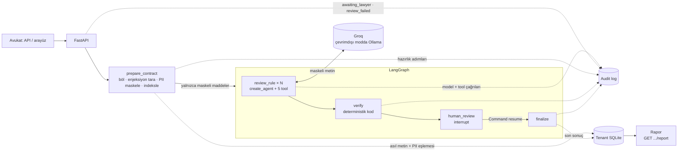

# Mimari

## 1. Genel bakış
Sistem dört katmandan oluşur: **Hazırlık → Agent → Doğrulama → İnsan**.

- **Hazırlık** düz Python fonksiyonlarıdır ve graph'tan **önce** çalışır: sözleşmeyi maddelere böler,
  enjeksiyon tarar, PII maskeler, indeksler. Böylece ham metin graph state'ine hiç girmez.
- **Agent, Doğrulama ve İnsan** katmanları bir LangGraph `StateGraph`'tır. Her kural için ayrı bir
  `create_agent` görevi çalışır; doğrulama düz koddur; graph tek bir `interrupt()` noktasında durur.
- Avukat kararını API'den verir ve graph `Command(resume=...)` ile biter. Son karardan sonra
  sonuçları, önerileri ve avukat kararlarını içeren bir rapor okunabilir.

İlke: **LLM önerir, kod karar verir, yalnızca avukat onaylar.**



## 2. Bileşenler
| Bileşen | Sorumluluk | Konum |
|---|---|---|
| API | Anahtardan tenant ve rol çözme, rol kontrolü, hazırlığı çağırma, inceleme başlatma, avukat kararını doğrulama ve maskeleme, role göre gösterim, audit ve rapor okuma, arayüz | `src/api.py` |
| Hazırlık | Madde bölme, enjeksiyon tarama, PII maskeleme, BM25 indeksi (graph dışında) | `src/prepare/` |
| Metin yardımcısı | Metni normalleştirir ve her karakterin asıl metindeki konumunu verir; enjeksiyon taraması ve alıntı doğrulaması aynı yardımcıyı kullanır, ikinci bir kopyası yazılmaz | `src/text.py` |
| Rapor | Saklanan sonuçtan JSON rapor üreten saf fonksiyon | `src/report.py` |
| Graph | 4 düğüm, `Send` ile kural başına dağıtım, tek `interrupt()` | `src/graph.py` |
| Kural agent'ı | `create_agent`, system prompt, audit middleware'leri, adım limiti | `src/agent.py` |
| Tool'lar | 5 tool; onay tool'u yok | `src/tools.py` |
| Doğrulama | Alıntı, sayı/birim, taslak kontrolü, avukat kuyruğu sinyalleri (saf fonksiyon) | `src/verify.py` |
| Config | Env okuma; başlangıçta sağlayıcı ve anahtar kontrolü (eksikse açık hatayla durur) | `src/config.py` |
| LLM | Sohbet modeli (Groq ya da Ollama) kurulumu; yeniden deneme ayarı | `src/llm.py` |
| Store | Tenant'a bağlı SQLite, üç tablo: `reviews` (asıl sözleşme metni, maskeli maddeler, işaretler, durum, doğrulanmış bulgular ve taslaklar, kararlar), `audit_log` (tetikleyiciyle yalnızca ekleme), `pii_map` | `src/store.py` |
| Modeller | pydantic şemaları: `Clause`, `Rule`, `Finding`, `Proposal`, `LawyerDecision`, `Report` | `src/models.py` |
| Arayüz | Bulguları ve enjeksiyon işaretlerini sözleşme metni üzerinde gösteren tek sayfa (karar API ucundan verilir) | `src/static/index.html` |

## 3. Veri akışı (ana senaryo)
1. `POST /reviews` gelir; gövdesi `{"text": "…"}`'tir. API anahtarından `tenant_id` ve rol çözülür
   (aşağıda "Kimlik ve rol"); tenant'ın kuralları yüklenir. İncelemeye bir `review_id` (UUID) verilir.
2. **Hazırlık (graph dışı, `prepare_contract()`), şu sırayla:**
   - **Sakla:** Asıl sözleşme metni değiştirilmeden tenant'ın `app.db`'sine kaydedilir.
   - **Böl:** Sözleşme maddelere bölünür; her madde asıl metindeki ofsetini taşır. `Madde 1`
     öncesindeki ve son maddeden sonraki metin de birer maddedir.
   - **Tara:** Enjeksiyon kalıpları ve gizli karakterler, görünmez karakterleri çıkarılmış bir
     kopyada taranır; eşleşme konumları asıl metne eşlenir (`src/text.py`). Şüpheli ifade
     **silinmez**, konumuyla işaretlenir. Modelin göreceği kopyadan yalnızca görünmez karakterler
     çıkarılır; görünen şüpheli cümle kalır. Görünmez karakter kümesi tek yerde tanımlanır.
   - **Maskele:** Kimlik bilgileri yer tutucularla değiştirilir (`[KISI_1]`, `[TCKN_1]`); eşleme
     yalnızca tenant'ın `app.db`'sine yazılır. Tutar, süre ve tarihler maskelenmez.
   - **İşareti maskele:** İşaretteki ifade (eşleşmenin geçtiği cümle) aynı eşlemeyle maskelenir;
     maskesiz hali saklanmaz.
   - **İndeksle:** Maskeli maddeler BM25 ile indekslenir. İndeks state'e konmaz; süreç içinde
     `review_id` anahtarlı bir sözlükte durur ve graph `interrupt`'a ulaşınca silinir.
   - Her adım audit log'a yazılır; audit olayları yükleri maskelendikten sonra yazılır.
3. Graph **yalnızca maskeli maddeler, kurallar, enjeksiyon işareti ve kimliklerle** başlar
   (`thread_id = review_id`).
4. **review_rule × N:** Her kural için bir agent çalışır ve tam olarak bir bulgu döner. Arar, maddeyi
   okur, `submit_finding` ile bildirir; gerekiyorsa `propose_change` ya da `escalate_to_lawyer` çağırır.
   Her model ve tool çağrısı audit log'a yazılır.
5. **verify:** Kod her bulguyu ve taslağı kontrol eder; `needs_review` işaretini ve sebep listesini
   koyar (LLM değil).
6. **human_review:** Graph `interrupt()` ile durur. Graph döndükten sonra API doğrulanmış bulguları
   ve taslakları (maskeli) `reviews` tablosuna yazar, durumu `awaiting_lawyer` yapar ve bulguları
   döner (çağıran `lawyer` olduğu için maskesiz). Bu andan sonra okuma uçları ve karar doğrulaması
   `reviews` tablosunu okur; checkpoint'i okumaz.
7. `POST /reviews/{id}/decision` gelir. API rolü ve kararı **graph'ı devam ettirmeden önce** kontrol
   eder, avukatın yazdığı düzenlenmiş metni maskeler (aşağıda) ve kararı verenin adını anahtardan
   alıp yüke ekler. Hepsi geçerse graph `Command(resume=maskeli karar)` ile devam eder.
8. **finalize:** Kararlar ve son durum (`approved` / `changes_requested`) audit log'a yazılır ve
   `reviews` kaydı son sonuçla tamamlanır. Kayıt raporun ihtiyaç duyduğu her şeyi içerir: her kural
   için `severity`, modelin sonucu, son sonuç, madde, alıntı, `needs_review` ve sebepleri, taslak ve
   `code_check`, avukat kararları; ayrıca sağlayıcı, model, karar zamanı ve kararı verenin adı.
   Rapor yalnızca bu kayıttan üretilir (`rules.yaml` sonradan değişse de rapor değişmez).

İnceleme durumları: `running → awaiting_lawyer → approved | changes_requested` (hata: `failed`).

### API uçları
| Uç | İş | Gerekli rol |
|---|---|---|
| `POST /reviews` | Sözleşme metnini alır (`{"text": "…"}`), hazırlar, graph'ı `interrupt`'a kadar çalıştırır, bulguları döner | `lawyer` |
| `POST /reviews/{id}/decision` | Bulgu kararları + taslak kararları + son karar (onay / değişiklik talebi), tek istekte | `lawyer` |
| `GET /reviews/{id}` | Durum, maddeler, enjeksiyon işaretleri, bulgular, taslaklar; `lawyer` için ayrıca asıl sözleşme metni | `lawyer` ya da `viewer` |
| `GET /reviews/{id}/report` | Son karardan sonra rapor (yalnızca JSON) | `lawyer` ya da `viewer` |
| `GET /reviews/{id}/audit` | İncelemenin audit kayıtları | `lawyer` ya da `viewer` |
| `GET /` | Basit arayüz (veri içermez; veriyi yukarıdaki uçlardan çeker) | — |

Bulgu ve taslak kararlarını değiştiren tek uç `/decision`'dır; avukat aşaması bilerek bu tek uçla
kurulur. Kural uç adına değil yönteme bağlıdır: **`GET` dışındaki her uç `lawyer` rolü ister.**
İleride eklenen bir yazma ucu da bu kurala girer; bunu bir test zorlar (`evals.md` §2).

### Role göre gösterim
| Veri | `lawyer` | `viewer` |
|---|---|---|
| Maddeler, alıntılar, taslaklar, rapor | **Maskesiz** (yer tutucular gerçek değerle değiştirilir) | **Maskeli** (yer tutucular olduğu gibi) |
| Enjeksiyon işaretleri | Madde, eşleşen ifade (maskesiz), asıl metindeki konum, gizli karakterlerin türü ve konumu | Madde ve eşleşen ifade (maskeli); konum yok |
| Asıl sözleşme metni (`original_text`) | Var; işaret konumları bu metne göre karakter ofsetidir | **Yok** |
| Audit kayıtları | Saklandığı gibi, maskeli | Saklandığı gibi, maskeli |

- Kural tüm okuma uçlarında ve arayüzde aynıdır. Maske açma tek bir fonksiyondadır ve yalnızca
  yanıt üretilirken, `lawyer` için çalışır; saklanan veri her zaman maskelidir (asıl sözleşme metni
  ve `pii_map` dışında).
- `viewer` için "konum yok" kuralı inceleme ve rapor yanıtlarına uygulanır; audit kayıtları iki rol
  için de saklandığı gibi döner.
- `viewer` asıl sözleşme metnini ve `pii_map`'i hiçbir uçtan alamaz.
- Arayüz veriyi API'den çektiği için aynı kurala kendiliğinden uyar.

### Kimlik ve rol
- Her istek `X-API-Key` başlığı taşır. Sunucu anahtarı `TENANT_API_KEYS` içinde arar; kayıt
  `tenant_id`, `role` (`lawyer` / `viewer`) ve `name` verir.
- **Tenant ve rol yalnızca buradan gelir.** İstek gövdesindeki, sorgu dizgisindeki ya da yoldaki
  `tenant`, `role`, `reviewer` gibi alanlar okunmaz; gönderilirse yok sayılır. İstemci bunları değiştiremez.
- Anahtarlar sunucu tarafında env'de durur; yanıtlarda ve loglarda yer almaz.
- Kontrol sırası (ilk tutmayan döner; graph ancak hepsi geçerse devam eder):

| Sıra | Kontrol | Tutmazsa |
|---|---|---|
| 1 | Anahtar var ve tanınıyor | **401** |
| 2 | Uç yazma ucuysa rol `lawyer` | **403** |
| 3 | İnceleme bu tenant'a ait (yalnızca kendi `app.db`'sinde aranır) | **404** |
| 4 | Durum uygun: karar ucu için `awaiting_lawyer`; rapor ucu için `approved` / `changes_requested` | **409** |
| 5 | Gövde geçerli (karar ucu, aşağıda) | **422** |

Rol kontrolü kaynağa bakmadan önce yapılır; `viewer` başka tenant'ın incelemesi için de 403 alır,
yani incelemenin var olup olmadığını öğrenemez.

### Avukat kararı (`LawyerDecision`)
```json
{
  "findings": [
    {
      "rule_id": "termination_notice",
      "action": "accept | correct",
      "status": "non_compliant",
      "proposal_action": "accept | edit | reject",
      "edited_text": "Taraflar sözleşmeyi 30 gün önceden yazılı bildirimle feshedebilir."
    }
  ],
  "contract_decision": "approve | request_changes"
}
```
**Kim neye karar verir.** Avukat her bulguya değil, yalnızca **avukat kuyruğundaki**
(`needs_review=true`) bulgulara karar vermek zorundadır (CASE.md'deki gibi). İsterse kuyruk
dışındaki bir bulguyu da düzeltebilir.

| Alan | Anlamı | Ne zaman zorunlu |
|---|---|---|
| `action` | Bulgu kararı: `accept` (olduğu gibi) ya da `correct` (sonucu değiştir). `reject` yoktur. | Kuyruktaki her bulgu için. Kuyruk dışındakiler için isteğe bağlı. |
| `status` | Düzeltilmiş sonuç: `compliant` / `non_compliant` / `not_found` | `action = correct` ise |
| `proposal_action` | Taslak kararı: `accept` / `edit` / `reject` | Taslağı olan **kuyruktaki** her bulgu için. Taslağı olan kuyruk dışı bulgularda isteğe bağlı. |
| `edited_text` | Avukatın düzenlediği taslak metni | `proposal_action = edit` ise |
| `contract_decision` | Son karar: `approve` (onay) ya da `request_changes` (değişiklik talebi) | Her zaman |

Gövde doğrulaması (kontrol 5) — biri tutmazsa **422**, graph devam etmez:
- Kuyruktaki her bulgu için `action` var.
- Taslağı olan kuyruktaki her bulgu için `proposal_action` var.
- `rule_id`'ler bu incelemeye ait ve tekrarsız.
- `action` yalnızca `accept` / `correct`; `correct` ise geçerli bir `status` var. `status` yalnızca
  `correct` ile verilir.
- `proposal_action` yalnızca taslağı olan bulguda verilir; `edit` ise boş olmayan `edited_text` var.
- Her girdide `action` ya da `proposal_action`'dan en az biri var. Kuyruk dışındaki bir bulgu
  yalnızca `proposal_action` ile gönderilebilir; `action` yoksa bulgu olduğu gibi kalır.
- `contract_decision` yalnızca `approve` / `request_changes`.

Son sonuç (raporda ve `reviews` kaydında):
- Bulgunun son sonucu: `action = correct` ise avukatın `status`'ü; değilse (`accept` ya da karar
  verilmemiş) modelin önerdiği `status`.
- Karar verilmeyen taslak (yalnızca kuyruk dışında olabilir) "karar verilmedi" (`proposal_action:
  null`) olarak görünür ve talep edilen değişikliklere **girmez**.
- Son sonucu `non_compliant` olmayan bir bulgunun taslağı talep edilen değişikliklere girmez.
- `request_changes`, talep edilen değişiklik listesi boş olsa da kabul edilir.

Kurallar:
- **Uygunsuz bulgu varken onay verilebilir.** Karar avukatındır; rapor bunu açıkça gösterir
  (`approved_with_noncompliant`, bulguların **son** sonucundan hesaplanır).
- **Düzenlenmiş metin maskelenir.** `edited_text`, saklanmadan ve graph'a verilmeden önce
  hazırlıktaki aynı maskeleyiciden, incelemenin mevcut eşlemesiyle geçer: bilinen değer aynı yer
  tutucuyu alır, yeni bir kimlik bilgisi eşlemeye eklenir. State, checkpoint, audit log ve trace
  yalnızca maskeli metni görür. Sınır: eşlemede olmayan yeni bir kişi adı yakalanmaz (serbest metin
  adlarıyla aynı sınır); TCKN, IBAN, telefon ve e-posta yakalanır.
- Düzenlenmiş metin kod kontrolünden geçmez; avukatın kararıdır.
- Avukat taslağı olmayan bir bulguya yeni taslak ekleyemez (kapsam dışı).
- Kararı kimin verdiği gövdeden değil anahtardan gelir: audit log'a `lawyer:<name>` yazılır.

### Rapor (`GET /reviews/{id}/report`)
- Yalnızca JSON. İstek anında, `reviews` tablosundaki son sonuçtan `src/report.py` ile üretilir;
  ayrı bir rapor dosyası saklanmaz. Okumak hiçbir şeyi değiştirmez.
- Son karar verilmeden istenirse **409** döner.
- Role göre gösterim kuralı geçerlidir (`lawyer` maskesiz, `viewer` maskeli).

| Bölüm | İçerik |
|---|---|
| Başlık | İnceleme kimliği, tarih, sağlayıcı ve model, kararı veren anahtarın adı |
| Son karar | `approved` / `changes_requested` |
| Uyarı | `approved_with_noncompliant`: son hali `non_compliant` olan bulgu varken onay verildiyse `true`, ilgili kurallarla birlikte |
| Kural sonuçları | Her kural için: önem (`severity`), modelin önerdiği sonuç, son sonuç, madde, alıntı, `needs_review` ve sebepleri, avukatın bulgu kararı |
| Taslaklar | Her taslak için: modelin metni, kod kontrolü sonucu, avukatın kararı (ya da "karar verilmedi"), varsa düzenlenmiş metin |
| Talep edilen değişiklikler | Avukatın **kabul ettiği** ve **düzenlediği** taslaklar (son metinleriyle). Reddedilenler burada yer almaz. |
| Enjeksiyon işaretleri | İşaretlenen maddeler, eşleşen ifade ve konumu, gizli karakterlerin konumu |

Yeniden yüklenen sözleşme yeni bir incelemedir; önceki incelemeyle bağlanmaz.

## 4. Klasör yapısı
```
src/
  api.py  config.py  llm.py  graph.py  agent.py  tools.py  verify.py  report.py  store.py  models.py
  text.py         # normalleştirme + asıl metindeki konuma eşleme (tek yardımcı)
  prepare/        clauses.py  injection.py  pii.py  index.py   # index.py: BM25
  prompts/        rule_agent.md
  static/         index.html
data/tenants/<tenant_id>/
  rules.yaml      # kural seti (repoda)
  app.db          # incelemeler (asıl metin dahil), audit log, PII eşlemesi (çalışma zamanı)
  checkpoints.db  # LangGraph state (çalışma zamanı)
evals/
  dataset/        # sentetik sözleşmeler + labels.json
  run.py  metrics.py
tests/
docs/             # karar dokümanı
```

## 5. Adlandırma kuralları
- Kod, tool adları ve durum değerleri İngilizce (`non_compliant`); dokümanlar ve prompt Türkçe.
- Tool adı `fiil_nesne`: `search_contract`, `submit_finding`.
- Prompt dosyaları: `src/prompts/<ad>.md`.
- Madde kimliği: `c<sıra>` (ör. `c7`); kural kimliği: `snake_case` (ör. `termination_notice`).
- PII yer tutucusu: `[TÜR_N]` (`[KISI_1]`, `[TCKN_2]`, `[IBAN_1]`).
- Test dosyası: `tests/test_<modül>.py`.

## 6. Dış entegrasyonlar
| Sistem | Erişim | Auth | Not |
|---|---|---|---|
| Groq | Sohbet modeli (varsayılan mod) | `GROQ_API_KEY` | Maskeli metin gider. 429'da `max_retries=3`; limitler organizasyon başına. Eşzamanlılık `MAX_CONCURRENCY` ile sınırlı |
| Ollama | Sohbet modeli (yalnızca çevrimdışı mod) | Yok (yerel ağ) | Varsayılan modda çalışmaz. Çevrimdışı modda `OLLAMA_NUM_PARALLEL=1`, `MAX_CONCURRENCY=1` |
| LangSmith | Eval + tracing (isteğe bağlı) | `LANGSMITH_API_KEY` | Trace'lere yalnızca maskeli veri gider. Eval dataset'i sentetik sözleşmeleri (sahte PII dahil) ham yükler. Anahtar yoksa hiçbir şey gitmez |

### Veri nereye gidiyor
| Veri | Varsayılan mod (Groq) | Çevrimdışı mod (Ollama) |
|---|---|---|
| Asıl sözleşme metni | Makinede kalır (tenant `app.db`) | Makinede kalır |
| PII eşlemesi (yer tutucu → gerçek değer) | Makinede kalır (tenant `app.db`) | Makinede kalır |
| Standart biçimde TCKN, IBAN, önekli telefon, e-posta, taraf/imza bloğundaki adlar | Gitmez (maskeli) | Gitmez |
| Maskeli madde metni, kural metni, agent mesajları | **Groq'a gider** | Makinede kalır |
| Tutarlar, fiyatlar, süreler, tarihler, ticari şartlar, şirket adları | **Groq'a gider** (maskelenmez; kurallar bunlara ihtiyaç duyar) | Makinede kalır |
| Avukatın düzenlediği taslak metni | Modele gitmez (karar agent çalıştıktan sonra verilir); maskeli saklanır | Makinede kalır |
| Maskelemenin kaçırdığı kimlik bilgileri (gövdede geçen ad, öneksiz telefon, boşluklu TCKN / IBAN) | **Groq'a gidebilir** | Makinede kalır |
| Trace (yalnızca `LANGSMITH_API_KEY` varsa) | LangSmith'e gider, maskeli | Kapalı tutulur |

Groq tarafı (2026-11-10'da okunan belgeler, `tech_stack.md`): varsayılan olarak saklamaz; güvenilirlik
ve kötüye kullanım incelemesi için girdi/çıktıyı 30 güne kadar loglayabilir; Zero Data Retention
açılırsa bu da kapanır; saklanan veri ABD'dedir; sözleşmesine göre eğitimde kullanamaz. Bunlar
Groq'un beyanıdır, sistemin garantisi değildir.

## 7. Mimari kararlar (kısa ADR)
### ADR-001: Parçala ve ara (tam sözleşmeyi modele verme)
- **Bağlam:** Kanıt madde düzeyinde isteniyor. Tüm sözleşmeyi her kural için göndermek token'ı
  (Groq'ta dakikalık limit ve ücret, yerelde bağlam) kural sayısıyla çarpar ve dışarı giden metni artırır.
- **Karar:** Sözleşme maddelere bölünür; agent ilgili maddeyi aramayla bulur. Arama yalnızca
  BM25'tir; vektör deposu ve sıralama birleştirme yoktur.
- **Alternatifler:** Tüm sözleşmeyi tek prompt'ta vermek. BM25'in yanına vektör araması eklemek
  (kapsamdaki sözleşmeler 15–40 madde; bunun için Groq modunda ~4,6 GB'lık Ollama imajı ve ayrı bir
  model indirtmek orantısız).
- **Sonuç:** Kısa prompt, madde kimliğiyle kanıt; Groq modunda Ollama gerekmez. Risk: BM25 kuralın
  sözcüklerini kullanmayan dolaylı ifadeyi kaçırabilir. Arama maddeyi kaçırırsa "bulunamadı" her
  durumda avukata gider (her `not_found` kuyruğa düşer); risk "arama isabeti" metriğiyle ölçülür
  (`evals.md` §4). İleride ilk eklenecek şey embedding'dir (hibrit arama).

### ADR-002: Kural başına ayrı agent görevi
- **Karar:** Graph `Send` ile her kural için aynı agent'ı ayrı çalıştırır.
- **Alternatifler:** Tek agent tüm kuralları sırayla işler.
- **Sonuç:** Kısa ve odaklı bağlam, bir kuralın hatası diğerini etkilemez. Bedel: daha fazla LLM çağrısı.

### ADR-003: Kararı kod verir
- **Karar:** Agent çıktısı öneridir. Alıntı, sayı/birim, taslak kontrolü ve avukat kuyruğu kararı
  `verify.py`'dedir. Kod sayıyı alıntıdan **kendisi** çıkarır; modelin verdiği değer yalnızca çapraz kontroldür.
- **Alternatifler:** Modelden güven puanı istemek; taslağı ikinci bir LLM'e sordurmak.
- **Sonuç:** Davranış test edilebilir ve tekrarlanabilir. Uygulamada doğrulamayı kapatan bir ayar yoktur.
- **Sınır (bilerek çözülmedi):** Kod yalnızca sabit eşikli kuralları (`check`) sayısal olarak
  doğrulayabilir. Sabit eşiği olmayan sayısal kurallarda (ör. "sorumluluk sınırı sözleşme bedelini
  aşamaz") yalnızca alıntı doğrulanır; sayısal olmayan kurallarda taslak "kod doğrulayamadı"
  etiketi alır. İkinci bir LLM kullanılmaz.

### ADR-004: Onay bir tool değil, graph'ta tek interrupt
- **Karar:** Agent'ın onay verebileceği tool yok. İnsan kararı `human_review` düğümünde alınır ve
  yalnızca `lawyer` rolündeki anahtarla gelen istek graph'ı devam ettirebilir.
- **Alternatifler:** `HumanInTheLoopMiddleware` ya da `approve_contract` tool'u.
- **Sonuç:** Gizli talimat modeli kandırsa bile onay üretemez; `viewer` anahtarı da üretemez.
  `human_review` devam ederken baştan çalıştığı için bu düğümde `interrupt()` öncesinde yan etki yoktur.

### ADR-009: Rol API anahtarına bağlıdır
- **Bağlam:** "Yalnızca avukat onaylar" ilkesi agent'a karşı tool yokluğuyla korunuyor; insanlara
  karşı da korunmalı. Tam kullanıcı yönetimi iki günlük kapsamı aşar.
- **Karar:** Her API anahtarı sunucuda bir `tenant_id` + `role` + `name` kaydına bağlıdır. `GET`
  dışındaki tüm uçlar tek bir `require_lawyer` bağımlılığından geçer.
- **Alternatifler:** Rolü istekte almak (istemci değiştirebilir); kullanıcı hesapları + JWT (kapsam dışı).
- **Sonuç:** İstemci şirketini ya da rolünü değiştiremez. Sınır: anahtarı ele geçiren o rolü kazanır;
  anahtar döndürme ve kişi bazlı kimlik yoktur.

### ADR-005: Sözleşme metni güvenilmeyen veridir
- **Karar:** Sözleşme metni system prompt'a girmez; yalnızca tool sonucu olarak, sınırlayıcı etiketler
  içinde verilir. Tarama şüpheli madde bulursa o sözleşmenin tüm bulguları avukata gider. Şüpheli
  ifade silinmez: asıl metin saklanır ve avukata konumuyla gösterilir; modelin kopyasından yalnızca
  görünmez karakterler çıkarılır.
- **Sonuç:** Savunma tek katmana dayanmaz: sınırlama + tarama + kod doğrulaması + onay tool'u yok.
  Taramanın yakalamadığı talimat için kalan katmanlar ayrıca ölçülür (`evals.md`, sözleşme 7).

### ADR-006: PII graph'tan önce maskelenir, eşleme tenant'ta kalır
- **Karar:** Maskeleme model, indeks, checkpoint ve trace'ten **önce**, graph dışında yapılır. Alıntı
  maskeli metne karşı doğrulanır; yalnızca `lawyer` rolüne gösterilirken geri açılır. Avukatın
  sonradan yazdığı düzenlenmiş taslak metni de aynı maskeleyiciden geçer.
- **Sonuç:** Modele ad, TCKN, telefon, e-posta, IBAN gitmez. Yalnızca kimlik bilgileri maskelenir;
  tutarlar, süreler, tarihler ve ticari şartlar maskelenmez (kurallar bunlara ihtiyaç duyuyor).
  Varsayılan modda "model" Groq olduğu için bunlar makineden çıkar; çıkmaması gerekiyorsa çevrimdışı
  mod kullanılır (ADR-010).

### ADR-007: Tenant başına ayrı dosyalar
- **Karar:** Her tenant'ın kuralları, `app.db`'si ve `checkpoints.db`'si kendi klasöründedir.
  İndeks inceleme başına bellekte kurulur; paylaşılan indeks yoktur.
- **Alternatifler:** Tek DB + `tenant_id` sütunu.
- **Sonuç:** Unutulan bir `WHERE` veri sızdıramaz. Bedel: tenant başına bir derlenmiş graph
  (`dict[tenant_id]` içinde önbelleğe alınır).

### ADR-008: Asıl kayıt kendi audit log'umuz
- **Karar:** Hazırlık adımları, model çağrıları, tool çağrıları, bulgular, doğrulama sonuçları, bulgu
  ve taslak kararları, son karar, rapor kaydı ve hata durumu tek bir SQLite tablosuna yazılır. Tablo
  **uygulama üzerinden değiştirilemez**: `UPDATE` ve `DELETE`'i reddeden SQLite tetikleyicileri vardır
  ve bunu bir test sınar. LangSmith yalnızca eval ve hata ayıklama içindir.
- **Sonuç:** İnternetsiz (banka) kurulumda LangSmith kapatılır ve çevrimdışı moda geçilir (ADR-010);
  kayıt tarafında hiçbir şey eksilmez.
- **Sınır (bilerek çözülmedi):** Koruma uygulama ve SQL düzeyindedir. `app.db` dosyasına doğrudan
  erişen biri (tetikleyiciyi düşürerek ya da dosyayı değiştirerek) kaydı değiştirebilir; imza ya da
  hash zinciri yoktur.

### ADR-011: Avukat aşaması en küçük haliyle
- **Bağlam:** Akışta avukat bulgulara ve taslaklara karar verir, son kararı verir ve bir rapor çıkar.
- **Karar:**
  - Karar yalnızca avukat kuyruğundaki bulgular için zorunludur (CASE.md: "emin olmadığı bulguyu
    avukata bırakır"); kuyruk dışındaki bulgular kodun doğruladığı haliyle kalır, avukat isterse düzeltir.
  - Kuyruğa iki tür bulgu düşer: belirsiz olanlar (bir doğrulama sinyali tutan) ve kanıtsız olanlar
    (her `not_found`; alıntı olmadığı için kodun doğrulayacağı bir şey yoktur).
  - Kuyruk tek bir işaret (`needs_review`) ve sebep listesidir; öncelik sıralaması yoktur.
  - Tek karar ucu: bulgu kararları, taslak kararları ve son karar aynı istekte gelir.
  - Son karar `approve` ya da `request_changes`'tir; "ret" yoktur.
  - Rapor yalnızca JSON'dur ve saklanan sonuçtan üretilir.
- **Alternatifler:** Her bulgu için zorunlu karar (avukatın iş yükünü kural sayısına çıkarır); bulgu
  başına ayrı uçlar ve taslak düzenleme ekranı; PDF rapor.
- **Sonuç:** Küçük ve test edilebilir bir yüzey. Sınır: sözleşme versiyon takibi yoktur; değişiklik
  talebinden sonra yeniden yüklenen sözleşme yeni bir incelemedir.

### ADR-010: Birincil sağlayıcı Groq, çevrimdışı mod Ollama
- **Bağlam:** CASE.md dış sağlayıcıyı varsayıyor ("model sağlayıcıya ne gidiyor?"). Eval iki günde
  defalarca koşulmalı ve değerlendiricinin makinesinde GPU olmayabilir.
- **Karar:** Varsayılan `LLM_PROVIDER=groq`, model `openai/gpt-oss-120b`. `LLM_PROVIDER=ollama`
  çevrimdışı moddur. Ollama yalnızca çevrimdışı modda çalışır; varsayılan modda başlamaz ve imajı
  inmez. PII maskeleme, arama, doğrulama, graph ve tool'lar iki modda aynıdır; fark yalnızca
  `src/llm.py`'dedir.
- **Alternatifler:** Yalnızca yerel model (yavaş, GPU ister); Groq'ta Llama modelleri (artık Enterprise).
- **Sonuçlar / ödünleşimler:**
  - Varsayılan modda maskeli metin, tutarlar ve ticari şartlar Groq'a gider ("Veri nereye gidiyor").
    "Veri makineden çıkmaz" yalnızca çevrimdışı mod için söylenebilir.
  - Bir dış bağımlılık ve hız limiti gelir: anahtar yoksa uygulama açık hatayla durur; 429'da sınırlı
    yeniden deneme yapılır, sonra kural avukat kuyruğuna düşer.
  - Geliştirme hesabında 250K TPM geçerli (teyit edildi); tam eval sığar. Düşük limitli bir hesapta
    (8K TPM / 200K TPD) sığmaz; Groq belgeleri hangi planın hangi limiti aldığında çelişkili olduğu
    için README düşük limit durumunu da anlatır.
  - İnternetsiz kurulumda değişen: `LLM_PROVIDER=ollama`, LangSmith kapalı. Docker imajları ve Ollama
    sohbet modeli (`qwen3.5:9b`) internet olan bir makinede hazırlanıp içeri taşınır
    (`ollama-pull` çalıştırılmaz; yalnızca `app` ve `ollama` başlatılır); sohbet modeli için ~8 GB VRAM'li GPU gerekir. Kod değişmez.
